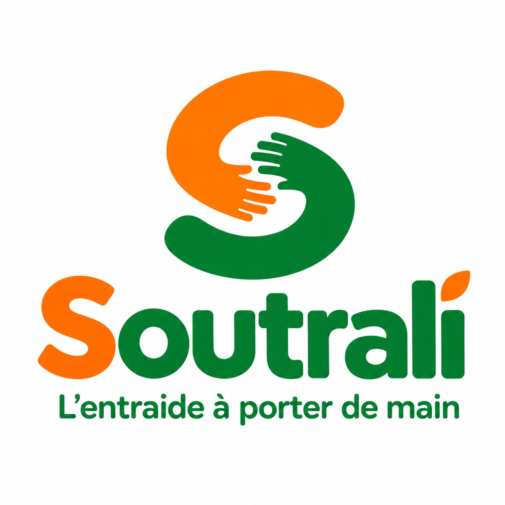
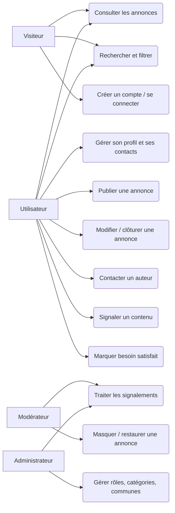
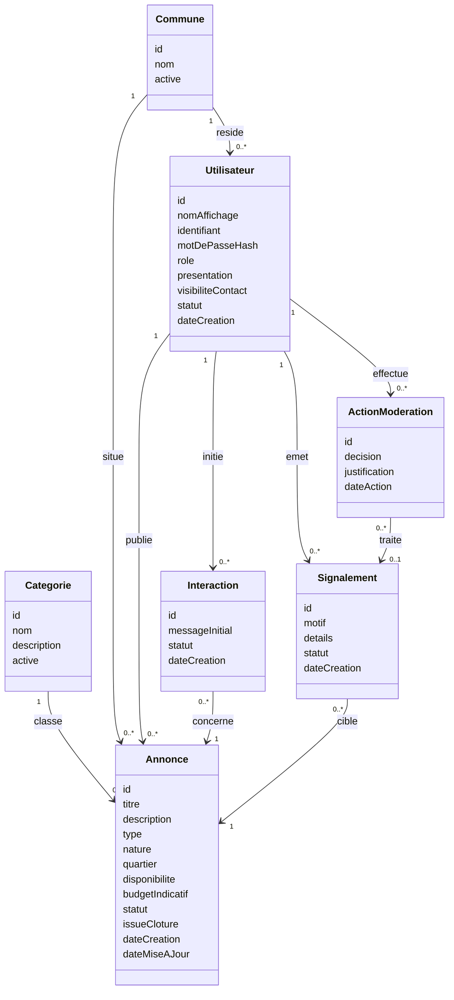
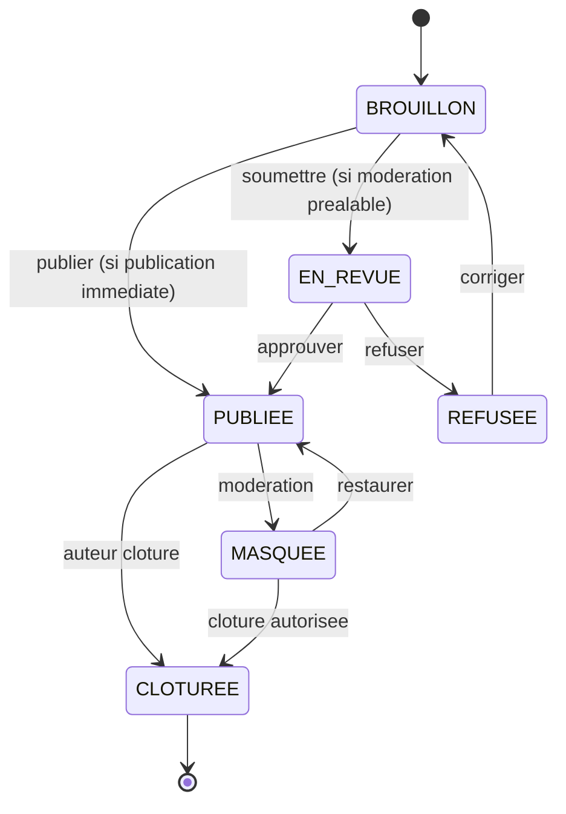
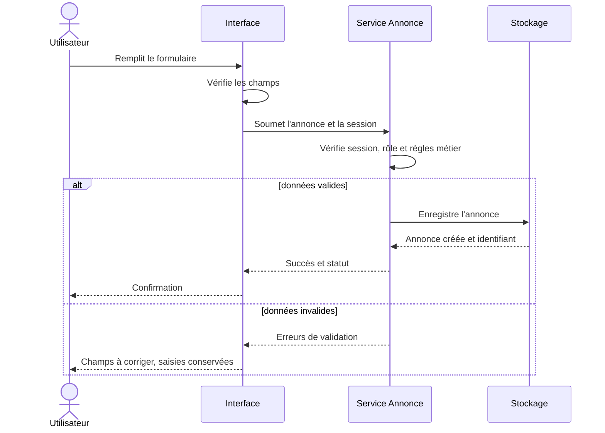

<p align="center">
  
</p>

# Soutrali — L’entraide à porter de main

Plateforme d’entraide et de services de proximité entre habitants d’une même ville de Côte d’Ivoire. Projet pilote : **Abidjan**.

> **Ce fichier est la source unique de contexte du projet.** Il est écrit pour qu’une personne, une équipe ou une IA qui n’a rien suivi puisse comprendre **ce qu’est Soutrali, pourquoi il existe, ce qui est décidé, ce qui ne l’est pas, et comment reprendre le travail avec n’importe quelle technologie**.
>
> **Neutralité technologique :** ce document ne choisit aucun langage, framework, base de données ni hébergeur. Le choix technique (« stack v3 ») sera fait ensuite, en équipe.
>
> **Version :** 4.1 · **Dernière mise à jour :** 22 octobre 2026 · **Langue de travail :** français · **Statut :** cadrage validé, socle technique en cours de construction.
>
> **Ce README reste le document unique de contexte fonctionnel** (décisions D-15 et D-16). Il décrit *ce qu’est Soutrali et ce qui est décidé*. Il ne décrit pas le code.

---

## Où est le code et la documentation technique

Depuis le 22 octobre 2026, ce dépôt contient le code source en plus du cadrage.

| Chemin | Contenu |
|---|---|
| `app/` | Application Flutter/Dart partagée — site web d’abord, Android ensuite (T-01) |
| `backend/` | Laravel 13 : API REST `/api/v1`, migrations, panneau Filament sur `/admin` |
| `docs/INSTALLATION.md` | **Commencer ici.** Prérequis, versions constatées, base de données, démarrage Web et API |
| `docs/SUIVI_DEVELOPPEMENT.md` | Journal technique étape par étape : ce qui est fait, vérifié, bloqué et restant |
| `docs/README_TECHNIQUE.md` | Architecture de référence détaillée (v1.0) |
| `docs/Soutrali_Stack_Technique_v3.docx` | **Décisions techniques T-01 à T-14 validées** par le porteur le 20 octobre 2026 |
| `docs/Soutrali_Cahier_des_Charges_UML_v2.docx` | Spécification détaillée et diagrammes UML — à valider |
| `docs/Soutrali_Charte_Graphique_v2.docx` | Logo, palette, typographie, composants — à valider |
| `docs/Soutrali_Stack_Technique_v0.1.docx` | Première réflexion technique — **remplacée par la v3, conservée pour historique** |
| `docs/archive/` | Documents de la phase 1, explicitement remplacés (§23) |
| `brand/logo/` | Logo de marque |
| `.github/workflows/ci.yml` | Intégration continue : Pest, Pint, Larastan, `flutter analyze`, `flutter test`, build web (T-12) |

**État en une phrase :** les référentiels T1 sont en base et exposés par l’API, le parcours navigateur → API → base est observé avec des données, mais le tir d’essai T1b reste incomplet (session Sanctum et mesures téléphone non faites) — lire `docs/SUIVI_DEVELOPPEMENT.md` avant toute intervention.

---

## Sommaire

→ [Où est le code et la documentation technique](#où-est-le-code-et-la-documentation-technique)

0. [Comment utiliser ce document](#0-comment-utiliser-ce-document)
1. [Soutrali en une minute](#1-soutrali-en-une-minute)
2. [Contexte et problème](#2-contexte-et-problème)
3. [Vision, mission, positionnement](#3-vision-mission-positionnement)
4. [Publics et acteurs](#4-publics-et-acteurs)
5. [Les 18 besoins et leur traitement](#5-les-18-besoins-et-leur-traitement)
6. [Périmètre du MVP](#6-périmètre-du-mvp)
7. [Parcours clés](#7-parcours-clés)
8. [Règles métier](#8-règles-métier)
9. [Modèle de données conceptuel](#9-modèle-de-données-conceptuel)
10. [Cycle de vie d’une annonce](#10-cycle-de-vie-dune-annonce)
11. [Écrans prévus](#11-écrans-prévus)
12. [Exigences non fonctionnelles](#12-exigences-non-fonctionnelles)
13. [Critères d’acceptation du MVP](#13-critères-dacceptation-du-mvp)
14. [Principes de conception](#14-principes-de-conception)
15. [Identité visuelle et ton](#15-identité-visuelle-et-ton)
16. [Confiance, sécurité et données personnelles](#16-confiance-sécurité-et-données-personnelles)
17. [Indicateurs d’évaluation du pilote](#17-indicateurs-dévaluation-du-pilote)
18. [Risques et mesures](#18-risques-et-mesures)
19. [Méthode de travail et règles de collaboration](#19-méthode-de-travail-et-règles-de-collaboration)
20. [Registre des décisions](#20-registre-des-décisions)
21. [Questions ouvertes](#21-questions-ouvertes)
22. [Guide de reprise (autre équipe, autre technologie)](#22-guide-de-reprise-autre-équipe-autre-technologie)
23. [Documents et fichiers du projet](#23-documents-et-fichiers-du-projet)
24. [Glossaire](#24-glossaire)
25. [Journal des séances](#25-journal-des-séances)
26. [Prochaines étapes](#26-prochaines-étapes)

---

## 0. Comment utiliser ce document

**Statuts utilisés partout :**

| Statut | Signification |
|---|---|
| **Validé** | Décidé par le porteur du projet. À respecter. |
| **Proposé** | Recommandation de l’équipe, pas encore validée. À ne pas présenter comme décidée. |
| **Ouvert** | Question à arbitrer. Ne pas la remplir par invention. |

**Identifiants :** `F-xx` fonctionnalités · `RM-xx` règles métier · `NF-xx` exigences non fonctionnelles · `CA-xx` critères d’acceptation · `D-xx` décisions · `UC-xx` cas d’utilisation.

**Ordre de lecture conseillé pour une nouvelle équipe :** §1 → §3 → §6 → §8 → §9 → §20 → §21 → §22. Le reste sert de référence détaillée.

**Origine des informations :** ce document consolide trois sources : le cadrage de la Phase 1 (18 besoins), le cahier des charges UML (v1 puis v2) et la charte graphique (v1 puis v2). En cas de contradiction, ce fichier fait foi pour l’état courant ; les documents Word détaillent les diagrammes et les tableaux.

---

## 1. Soutrali en une minute

- **Quoi :** un endroit unique où les habitants d’une ville publient une **demande d’aide** ou une **offre de service**, se retrouvent par commune et par catégorie, puis prennent contact.
- **Pour qui :** les habitants d’Abidjan : personnes qui cherchent de l’aide, prestataires de petits services, volontaires.
- **Pourquoi :** aujourd’hui, ces mises en relation passent par les connaissances, les appels et les groupes de discussion ; les demandes se perdent et les compétences manquent de visibilité.
- **Comment, au départ :** un produit minimum viable (MVP) simple, pensé d’abord pour le téléphone, sans paiement, sans livraison, sans vérification d’identité exhaustive.
- **Double objectif :** (1) un service utile aux habitants ; (2) **expérimenter une méthode de travail collaboratif reproductible** (IA, développeurs, chefs de projet, maîtrise d’ouvrage) de l’idée à la présentation à la MOA.
- **Garde-fou :** Soutrali n’est ni un ERP, ni un CRM, ni un logiciel de gestion d’entreprise, ni une place de marché complexe dès la première version.

---

## 2. Contexte et problème

Dans la vie quotidienne en Côte d’Ivoire, de nombreuses personnes ont du mal à trouver vite quelqu’un pour résoudre un problème ou accomplir une tâche : plombier, mécanicien, répétiteur, réparateur de téléphone, personne pour transporter un meuble, aide ponctuelle.

À l’inverse, des personnes possèdent des compétences, du temps ou des ressources utiles à d’autres, sans moyen efficace de faire connaître leurs disponibilités.

Les canaux actuels (connaissances personnelles, appels, groupes de messagerie, réseaux sociaux, déplacements) fonctionnent, mais présentent des limites :

- les demandes se perdent dans les conversations ;
- il est difficile de trouver une personne compétente pour un besoin précis ;
- les informations sur les prestataires sont dispersées ;
- les personnes compétentes manquent de visibilité ;
- les demandes urgentes ne trouvent pas toujours de réponse rapide ;
- on ne sait pas toujours vers qui se tourner ;
- il est difficile de distinguer les offres sérieuses des annonces peu fiables.

Soutrali veut apporter une réponse numérique simple à ces difficultés, sans prétendre les supprimer toutes.

---

## 3. Vision, mission, positionnement

**Vision.** Devenir une plateforme de référence pour faciliter l’entraide, la recherche de services et la mise en relation entre les habitants d’une même ville de Côte d’Ivoire.

**Mission.** Permettre à chaque utilisateur de :

- trouver une personne susceptible de répondre à un besoin ;
- publier une demande d’aide ou de service ;
- proposer ses compétences et ses disponibilités ;
- découvrir les services proposés par d’autres habitants ;
- entrer en contact avec les personnes intéressées ;
- participer à un réseau local d’entraide.

**Positionnement.** Soutrali n’est pas qu’un annuaire de professionnels. Il réunit trois dimensions :

| Dimension | Sens |
|---|---|
| **Entraide** | Demander ou proposer une aide ponctuelle, bénévole ou non |
| **Services** | Trouver ou proposer des prestations, rémunérées ou gratuites |
| **Opportunités** | Donner de la visibilité aux compétences, aux disponibilités et aux petites activités des habitants |

**Distinction essentielle :** une aide **bénévole** ne doit jamais être présentée comme une prestation **commerciale**.

**Périmètre géographique.** Une **ville**, et non un quartier. Ville pilote : **Abidjan** (validé). Le lancement dans une seule ville ne limite pas définitivement le projet à cette ville.

**Objectifs spécifiques du pilote :**

1. Permettre aux habitants de publier des demandes et des offres.
2. Permettre aux prestataires et volontaires de proposer leur aide.
3. Faciliter la recherche par catégorie et zone.
4. Simplifier la consultation des offres et demandes.
5. Faciliter la prise de contact.
6. Mettre en place une modération et un signalement élémentaires.
7. Tester la plateforme auprès d’un petit groupe d’utilisateurs.
8. Évaluer l’utilité réelle du service et les améliorations nécessaires.

---

## 4. Publics et acteurs

### 4.1 Publics concernés

| Public | Besoin | Exemples |
|---|---|---|
| Habitants qui cherchent de l’aide | Trouver vite une personne pour un besoin personnel, familial ou pratique | Réparateur de téléphone, répétiteur pour un enfant, aide au déménagement, mécanicien, couturière, petite course |
| Personnes qui proposent des services | Gagner en visibilité auprès des habitants de leur ville | Artisans, réparateurs, mécaniciens, plombiers, électriciens, couturiers, coiffeurs, répétiteurs, informaticiens |
| Personnes qui offrent une aide ponctuelle | Consacrer du temps à une activité utile | Étudiants, travailleurs, retraités, bénévoles : aide numérique à une personne âgée, aider un voisin à transporter un objet, partager une compétence |
| Petits entrepreneurs et indépendants | Présenter leurs services sans site Internet ni solution commerciale complexe | Petites activités locales |
| Associations et initiatives solidaires | **Évolution future**, cadrage spécifique requis (règles de publication, vérification, suivi) | Actions de solidarité, collectes de biens |

### 4.2 Acteurs du système

Les rôles « demandeur » et « prestataire / volontaire » sont des **rôles métier** qu’un même compte peut prendre tour à tour, pas des types de compte distincts.

| Acteur | Description | Droits principaux |
|---|---|---|
| **Visiteur** | Personne non connectée | Voir les annonces publiques, rechercher, s’inscrire ou se connecter. Ne voit **aucune coordonnée**. |
| **Utilisateur** | Habitant inscrit | Gérer son profil, publier et gérer ses annonces, contacter un auteur, signaler. |
| **Demandeur** (rôle métier) | Utilisateur qui publie une demande | Décrire le besoin, répondre aux prises de contact, clôturer la demande. |
| **Prestataire / volontaire** (rôle métier) | Utilisateur qui publie une offre ou répond à une demande | Publier une offre, répondre aux demandes, indiquer ses disponibilités. |
| **Modérateur** | Personne autorisée à traiter les abus | Examiner les signalements, masquer ou restaurer une annonce, proposer une suspension. |
| **Administrateur** | Responsable de la plateforme | Gérer rôles, catégories, communes, paramètres, comptes modérateurs, suspensions. |

Au prototype, les permissions restent simples : pas de système complexe de droits.

---

## 5. Les 18 besoins et leur traitement

Ces besoins sont l’origine fonctionnelle du projet. Le tableau indique comment chacun est traité (**MVP**, **après le MVP**, **hors périmètre**). Statut du classement : **Proposé**.

| # | Besoin | Réponse de Soutrali | Périmètre |
|---|---|---|---|
| 1 | Trouver rapidement quelqu’un pour résoudre un problème | Recherche par commune, catégorie et mot-clé | MVP |
| 2 | Publier une demande d’aide | Annonce de type DEMANDE (titre, description, catégorie, commune, période souhaitée, nature bénévole/rémunérée, contact) | MVP |
| 3 | Proposer ses compétences | Annonce de type OFFRE (description, zone d’intervention, modalités de contact) | MVP |
| 4 | Trouver un service dans une ville donnée | Filtres : commune, catégorie, type, nature, mot-clé | MVP |
| 5 | Trouver une aide ponctuelle (bénévole) | Nature = BÉNÉVOLE, distinguée des prestations commerciales | MVP |
| 6 | Trouver un petit travail ou une mission ponctuelle | Catégorie « Petites missions » + nature RÉMUNÉRÉE ; règles anti-fraude | MVP |
| 7 | Donner de la visibilité aux petits prestataires | Profil + annonces OFFRE ; coordonnées publiées avec consentement ; fiches enrichies (photos, avis) plus tard | MVP (version simple) |
| 8 | Trouver quelqu’un pour un besoin domestique | Catégories simples ; vigilance sécurité pour l’accès au domicile | MVP avec avertissements |
| 9 | Aide aux études et à la formation | Catégorie Éducation ; règles de protection des mineurs | MVP avec règles |
| 10 | Aide numérique ou administrative | Catégorie dédiée ; ne pas confondre avec du conseil réglementé ; ne pas garantir qu’une démarche aboutit | MVP |
| 11 | Aide pour une personne vulnérable | Exige vérification et sécurité renforcées ; ne pas confondre avec un service médical | **Hors MVP** |
| 12 | Actions d’entraide collective | Collectes d’argent et appels à la solidarité : règles spécifiques | **Hors MVP** |
| 13 | Réduire le temps de recherche d’un prestataire | Catalogue unique, filtrable | MVP |
| 14 | Faciliter la mise en relation entre habitants | Prise de contact (F-06) | MVP |
| 15 | Améliorer la confiance | Signalement, modération, informations claires, minimisation des données, suspension ; un compte n’est **pas** une identité vérifiée | MVP (élémentaire) |
| 16 | Suivre ses demandes | « Mes annonces » : modifier, clôturer, indiquer « besoin satisfait » | MVP |
| 17 | Faire connaître ses disponibilités | Simple mention textuelle ; pas de calendrier complexe | MVP (simple) |
| 18 | Favoriser les échanges locaux et l’activité économique | Effet à mesurer, **non garanti** | Indicateur |

**Domaines couverts à long terme** (vision, pas MVP) : entraide entre habitants · services de proximité · éducation et formation · petites missions · assistance numérique · solidarité collective · recherche et mise en relation · confiance et suivi.

---

## 6. Périmètre du MVP

### 6.1 Fonctionnalités incluses

| ID | Fonctionnalité | Description | Priorité |
|---|---|---|---|
| F-01 | Compte et authentification | Inscription, connexion, déconnexion, récupération d’accès. Méthode à décider (D-04) | Essentiel |
| F-02 | Profil utilisateur | Nom d’affichage, commune, courte présentation, canaux de contact choisis et leur visibilité | Essentiel |
| F-03 | Publier une annonce | Demande ou offre ; **nature bénévole ou rémunérée** ; catégorie ; description ; commune et quartier ; disponibilité ; budget indicatif si rémunérée | Essentiel |
| F-04 | Explorer les annonces | Liste paginée, détail, mots-clés, filtres commune / catégorie / type / nature | Essentiel |
| F-05 | Gérer ses annonces | Modifier, retirer, clôturer, indiquer « besoin satisfait », consulter l’historique | Essentiel |
| F-06 | Contacter un auteur | Contact via le canal choisi par l’auteur, réservé aux utilisateurs connectés ; trace de l’interaction (D-05) | Essentiel |
| F-07 | Signaler un contenu | Motif, détails, suivi du statut | Essentiel |
| F-08 | Modération | File de signalements, masquer / restaurer, suspendre un compte, historique | Essentiel |
| F-13 | Référentiels | Gestion par l’administrateur des catégories et des communes / zones d’Abidjan | Essentiel |
| F-09 | Notifications | Confirmation de publication, événements majeurs | Souhaitable |

### 6.2 Hors MVP

| ID | Élément | Raison |
|---|---|---|
| F-10 | Évaluations réciproques après échange | Exige un dispositif de contrôle contre les abus |
| F-11 | Paiement en ligne, portefeuille, séquestre | Complexité financière et réglementaire ; inutile pour tester l’utilité |
| F-12 | Géolocalisation en temps réel | Données sensibles et coûteuses ; la commune suffit |
| F-14 | Aide aux personnes vulnérables | Vérification et sécurité renforcées nécessaires |
| F-15 | Collectes d’argent, actions collectives | Règles spécifiques de vérification et de publication |
| F-16 | Fiches enrichies (photos de réalisations, avis) | Après le MVP si le besoin est établi |
| — | Application mobile native, vérification d’identité exhaustive, livraison ou logistique intégrée, système complexe de réputation ou de recommandation, fonctions de gestion d’entreprise, automatisations complexes, architecture surdimensionnée | Exclus par le cadrage ; évolution possible vers une application installable plus tard |

> **Règle :** ne rien ajouter à ce périmètre sans expliquer le besoin, les coûts et les conséquences, puis obtenir une décision explicite.

---

## 7. Parcours clés

### 7.1 Publier une annonce (UC-01)

- **Acteur :** utilisateur connecté (compte actif).
- **Déclencheur :** il choisit « Publier une annonce ».
- **Scénario nominal :** 1. choisir demande ou offre · 2. saisir titre, catégorie, description, commune, disponibilité · 3. indiquer la nature (bénévole ou rémunérée) et, si rémunérée, un budget indicatif · 4. prévisualiser · 5. confirmer · 6. le système valide et enregistre · 7. confirmation et statut affichés.
- **Exceptions :** champ obligatoire manquant ; contenu interdit ; session expirée ; erreur réseau. L’erreur est expliquée **sans perdre les champs saisis** autant que possible.
- **Résultat :** annonce enregistrée avec identifiant, auteur, date et statut initial.

### 7.2 Rechercher une annonce (UC-02)

- **Acteur :** visiteur ou utilisateur.
- **Scénario :** saisir un mot-clé (facultatif), choisir commune, catégorie, type, nature, lancer la recherche. Le système affiche une liste paginée, ou un **état vide explicite** si aucun résultat.
- **Exceptions :** paramètres invalides, service indisponible → proposer de réessayer.
- **Résultat :** les résultats respectent les critères et les règles de visibilité.

### 7.3 Contacter l’auteur d’une annonce (UC-03)

- **Préconditions :** utilisateur connecté ; annonce visible et non clôturée ; canal de contact disponible.
- **Scénario :** ouvrir le détail → choisir « contacter » → le canal choisi par l’auteur est proposé → confirmation.
- **Règles :** les coordonnées privées ne sont jamais publiques par défaut ; blocage et signalement prévus.
- **Résultat :** une interaction est tracée.

### 7.4 Signaler et traiter un signalement (UC-04)

- **Utilisateur :** signale une annonce avec un motif et des détails facultatifs ; reçoit une confirmation et peut suivre le statut.
- **Modérateur :** consulte la file, ouvre le signalement, examine le contenu, choisit une action (classer sans suite, masquer, restaurer, demander une correction, transmettre à l’administrateur), saisit une justification si nécessaire, confirme.
- **Résultat :** décision, auteur de la décision, date et historique enregistrés. **Un signalement ne vaut pas suppression automatique** (RM-08).

### 7.5 Clôturer une demande (UC-05)

L’auteur clôture son annonce et indique l’issue : **satisfaite**, **non satisfaite** ou **abandonnée**. Cette information alimente les indicateurs du pilote.

### 7.6 Gérer les référentiels (UC-06)

L’administrateur crée, renomme ou désactive des catégories et des communes. Une catégorie désactivée n’est plus proposée, mais les annonces existantes restent consultables.



---

## 8. Règles métier

| ID | Règle | Statut |
|---|---|---|
| RM-01 | Seul un utilisateur authentifié peut publier, modifier ou clôturer une annonce. | Proposé |
| RM-02 | Un utilisateur ne peut modifier ou supprimer que ses propres annonces, sauf rôle de modération autorisé. | Proposé |
| RM-03 | Chaque annonce a un type : DEMANDE ou OFFRE. | Proposé |
| RM-04 | Une annonce publiée contient au minimum un titre, une catégorie, une description et une zone géographique suffisamment générale. | Proposé |
| RM-05 | Les coordonnées privées ne sont **jamais** visibles des visiteurs non connectés. Chaque utilisateur choisit quels canaux il rend visibles aux utilisateurs connectés (consentement explicite et révocable). | Proposé |
| RM-06 | Une annonce clôturée disparaît des résultats actifs mais reste visible de son auteur dans son historique. | Proposé |
| RM-07 | Les actions de modération sont traçables. | Proposé |
| RM-08 | Un signalement ne garantit pas la suppression : une décision de modération est nécessaire. | Proposé |
| RM-09 | Sont interdits les contenus illicites, frauduleux, discriminatoires, menaçants, ou exposant des données personnelles non nécessaires. | Proposé |
| RM-10 | La plateforme indique clairement qu’elle **facilite la mise en relation** et ne garantit pas, par défaut, l’exécution d’un service. | Proposé |
| RM-11 | L’interface distingue « informations déclarées » et « informations vérifiées ». Tant qu’aucune vérification n’existe, aucune mention « vérifié » n’est affichée. | Proposé |
| RM-12 | Une annonce concernant un mineur (cours, garde, accompagnement) est publiée par un adulte. Aucune donnée permettant d’identifier ou de localiser un mineur n’est publiée (nom complet, école, adresse). Âge minimum d’inscription : à décider (D-11). | Proposé |
| RM-13 | Aide aux personnes vulnérables, collectes d’argent et appels à dons : interdits au MVP et signalables. | Proposé |
| RM-14 | Pour les services à domicile, un message de prudence est affiché ; son contenu exact est à valider avec la MOA. | Proposé |
| RM-15 | Une annonce de nature BÉNÉVOLE ne comporte pas de budget. Une aide bénévole n’est pas présentée comme une prestation commerciale. | Proposé |
| RM-16 | Un utilisateur a un rôle unique : UTILISATEUR, MODÉRATEUR ou ADMINISTRATEUR. Les droits sont vérifiés côté serveur. | Proposé |

---

## 9. Modèle de données conceptuel

Modèle **logique et indépendant de toute technologie**. Les types et cardinalités sont indicatifs ; ils seront alignés avec la base de données par la future équipe technique.

### 9.1 Entités

| Entité | Responsabilité | Attributs principaux |
|---|---|---|
| **Utilisateur** | Compte, profil, identité applicative | id, nom d’affichage, identifiant (e-mail ou téléphone, D-04), secret **stocké sous forme hachée**, rôle, commune, présentation, visibilité des contacts, statut, date de création |
| **Annonce** | Demande ou offre publiée | id, titre, description, type, **nature**, quartier (libre), disponibilité (texte), budget indicatif (facultatif), statut, issue de clôture (facultative), dates de création et de mise à jour |
| **Catégorie** | Taxonomie des besoins et services | id, nom, description, active |
| **Commune** | Référentiel géographique | id, nom, active |
| **Interaction** | Trace d’une prise de contact | id, message initial, statut, date de création ; contenu non public |
| **Signalement** | Remontée d’un abus | id, motif (obligatoire), détails, statut, date de création ; accès restreint |
| **ActionModération** | Historique des décisions | id, décision, justification, date ; modérateur identifié |

**Relations :** un utilisateur publie 0..n annonces · une catégorie classe 0..n annonces · une commune situe 0..n annonces et utilisateurs · un utilisateur initie 0..n interactions, chacune concerne une annonce · un utilisateur émet 0..n signalements, chacun cible une annonce · un utilisateur (modérateur) effectue 0..n actions de modération, chacune traite 0..1 signalement.

### 9.2 Énumérations

```
TypeAnnonce        = DEMANDE | OFFRE
NatureAnnonce      = BENEVOLE | REMUNEREE
RoleUtilisateur    = UTILISATEUR | MODERATEUR | ADMINISTRATEUR
StatutCompte       = ACTIF | SUSPENDU | SUPPRIME
StatutAnnonce      = BROUILLON | EN_REVUE | PUBLIEE | MASQUEE | CLOTUREE | REFUSEE
StatutInteraction  = OUVERTE | REPONDUE | FERMEE | SIGNALEE
StatutSignalement  = NOUVEAU | EN_COURS | TRAITE | CLASSE_SANS_SUITE
IssueCloture       = SATISFAITE | NON_SATISFAITE | ABANDONNEE
```

### 9.3 Diagramme de classes



---

## 10. Cycle de vie d’une annonce



La modération préalable est activable ou non pour le pilote (D-06). Cette décision change le parcours de publication : **à trancher avant le développement**.

**Séquence de publication :**



---

## 11. Écrans prévus

| Écran | Contenu minimal |
|---|---|
| Accueil | Présentation claire, sélecteur de commune, recherche, catégories fréquentes, accès à la publication |
| Résultats | Recherche, filtres, liste paginée, états de chargement, état vide explicite |
| Détail d’annonce | Titre, type, nature (par un libellé), description, catégorie, commune, disponibilité, auteur, date, action de contact, signalement |
| Inscription / connexion | Formulaire court, erreurs accessibles, récupération d’accès |
| Profil | Informations publiques choisies, annonces de l’utilisateur, modification |
| Créer / modifier une annonce | Formulaire guidé, validation, prévisualisation, confirmation |
| Mes annonces | Statuts, actions modifier / clôturer / retirer, issue de clôture |
| Signalement | Motif, détails facultatifs, confirmation |
| Modération | File de signalements, détail, décision, justification, historique |
| Administration | Catégories, communes, rôles ; accès limité |

Les maquettes détaillées sont à produire (Phase 3) à partir de la charte graphique.

---

## 12. Exigences non fonctionnelles

Les cibles sont des **propositions de cadrage** à valider par la MOA ; ce ne sont pas des engagements contractuels.

| ID | Domaine | Exigence |
|---|---|---|
| NF-01 | Responsive | Utilisable dès 360 px de large, sans défilement horizontal global |
| NF-02 | Performance | Affichage initial perçu rapide ; viser un LCP ≤ 2,5 s au 75e percentile sur les pages clés, dans des conditions de mesure à définir |
| NF-03 | Disponibilité | Objectif du pilote à définir ; sauvegardes et procédure de restauration prévues |
| NF-04 | Sécurité | HTTPS en production, contrôle d’accès côté serveur, hachage des mots de passe, limitation des tentatives, validation des entrées |
| NF-05 | Confidentialité | Collecter le minimum, limiter l’exposition des contacts, documenter la conservation, permettre la suppression selon la politique validée |
| NF-06 | Accessibilité | Cible WCAG 2.2 AA sur les parcours principaux : clavier, focus, libellés, contraste |
| NF-07 | Compatibilité | Versions récentes des principaux navigateurs mobiles et ordinateur ; tests sur Android courant |
| NF-08 | Résilience | Messages d’erreur compréhensibles, reprise après erreur réseau, conservation des saisies |
| NF-09 | Maintenabilité | Code structuré, tests automatisés des règles critiques, documentation d’installation, variables centralisées |
| NF-10 | Traçabilité | Journaliser les actions de modération et les événements de sécurité sans enregistrer de données sensibles inutiles |
| NF-11 | Réseau variable | Pages légères, pas de média lourd obligatoire ; seuils de poids à définir après mesure sur appareils réels |
| NF-12 | Marque | Conformité à la charte graphique v2 |
| NF-13 | Reproductibilité | Dépôt unique versionné ; ce README et la documentation technique permettent à un nouvel intervenant de reprendre le travail |

---

## 13. Critères d’acceptation du MVP

| ID | Critère vérifiable |
|---|---|
| CA-01 | Un visiteur peut rechercher et consulter une annonce publique sans compte. |
| CA-02 | Un utilisateur non connecté ne peut ni publier ni modifier une annonce. |
| CA-03 | Une annonce valide est enregistrée avec auteur, catégorie, type, statut et dates. |
| CA-04 | Une annonce invalide est refusée avec des messages de correction compréhensibles. |
| CA-05 | Un utilisateur peut modifier et clôturer ses annonces, pas celles d’autrui. |
| CA-06 | Les filtres combinés ne retournent que les annonces correspondantes et visibles. |
| CA-07 | Un utilisateur peut signaler une annonce ; le signalement apparaît dans la file de modération. |
| CA-08 | Un modérateur peut enregistrer une décision, datée et attribuée à son compte. |
| CA-09 | Les écrans essentiels restent utilisables sur un téléphone de 360 px de large. |
| CA-10 | Les erreurs serveur et réseau sont présentées sans exposer de détails techniques sensibles. |
| CA-11 | Le filtre par commune ne retourne que les annonces de cette commune. |
| CA-12 | Chaque annonce affiche sa nature (bénévole / rémunérée) par un libellé, pas par la seule couleur. |
| CA-13 | Un visiteur ne voit aucune coordonnée ; un utilisateur connecté ne voit que les canaux autorisés par l’auteur. |
| CA-14 | L’administrateur peut ajouter ou désactiver une catégorie ; une catégorie désactivée n’est plus proposée, mais les annonces existantes restent consultables. |
| CA-15 | Une demande peut être clôturée avec une issue (satisfaite, non satisfaite, abandonnée). |

**Le MVP est aligné avec la vision si un utilisateur peut :** comprendre vite à quoi sert Soutrali ; consulter les annonces de sa ville ou zone ; publier sans difficulté inutile ; retrouver et gérer ses annonces ; contacter une personne selon les règles de confidentialité ; signaler un contenu ; utiliser l’essentiel sur un téléphone. Aucun seuil de réussite chiffré n’est fixé avant validation.

---

## 14. Principes de conception

Toute proposition concernant Soutrali doit les respecter.

1. **Utilité quotidienne** : partir de besoins concrets des habitants ; chaque fonctionnalité répond à un besoin identifié.
2. **Simplicité** : limiter les étapes et les champs inutiles.
3. **Accessibilité mobile** : écrans lisibles et utilisables sur téléphone d’abord, sans exclure l’ordinateur.
4. **Contexte ivoirien** : tenir compte des usages, de la connectivité, des moyens de contact, sans suppositions non vérifiées.
5. **Confiance et prudence** : règles claires, signalement, modération.
6. **Protection des données** : ne collecter que le nécessaire ; ne pas exposer de coordonnées sans décision explicite.
7. **Transparence** : distinguer l’information déclarée de l’information vérifiée.
8. **Sobriété technique** : éviter ce qui exige une infrastructure coûteuse ou des intégrations complexes.
9. **Évolutivité raisonnable** : base simple, maintenable, documentée, capable d’accueillir de nouvelles catégories et fonctionnalités après validation du prototype.
10. **Cohérence** : ne pas contredire les décisions validées.
11. **Validation humaine** : signaler les décisions ouvertes plutôt que les inventer.

---

## 15. Identité visuelle et ton

### 15.1 Marque

- **Nom :** Soutrali. **Signature :** « L’entraide à porter de main ».
- **Sens à transmettre :** solidarité, proximité, accessibilité, confiance, action concrète. Chaleureux sans être enfantin ; moderne sans ressembler à un kit d’interface générique.
- **Logo :** deux mains entrelacées formant un « S », l’une orange et l’autre verte. Mot-symbole : « S » orange, « outrali » vert, accent orange en forme de feuille sur le « i ».
- **Statut (D-02) :** le logo reçu est un **modèle de départ** ; il reste à confirmer comme logo de lancement ou à retravailler.

### 15.2 Variantes et usage du logo

| Variante | Usage |
|---|---|
| Vertical + signature | Accueil, couverture, supports institutionnels |
| Vertical sans signature | Quand la signature est illisible |
| Horizontal | En-tête du site, pied de page, documents |
| Symbole seul | Avatar, icône, petite zone |
| Monochrome noir / blanc | Tampon, impression une couleur, fonds complexes |
| Inversée | Fond vert profond : parties vertes en blanc, orange conservé |

Règles : zone de protection au moins égale à la hauteur du « S » du mot-symbole ; ne pas étirer, incliner, ombrer, contourer ni recolorer ; aplat de contraste sur photo ; tailles minimales indicatives : logo complet 140 px de large, symbole seul 24 px (idéalement 32 px et plus).

### 15.3 Palette (v2, statut Proposé)

Couleurs de marque **mesurées** sur le logo ; couleurs d’interface dérivées pour la lisibilité.

| Rôle | Couleur | Usage |
|---|---|---|
| Orange Soutrali | `#FE7402` | Actions principales (avec **texte sombre**), accents |
| Vert Soutrali | `#037C30` | Marque, titres, liens, boutons secondaires (texte blanc) |
| Vert profond | `#0B5A2A` | Survol, états actifs, fonds sombres |
| Orange texte | `#B24A00` | Orange lisible en texte sur fond clair |
| Ivoire chaud | `#FFF9F2` | Fond de page |
| Texte principal | `#1F2A24` | Titres et texte courant |
| Texte secondaire | `#5A6B62` | Aides, métadonnées |
| Vert pâle | `#E8F5EC` | Blocs informatifs |
| Orange pâle | `#FFF0E0` | Mise en évidence secondaire |
| Bordure | `#DCE5DF` | Contours, séparateurs |
| Blanc | `#FFFFFF` | Cartes, champs, fonds inversés |
| Danger | `#B3261E` | Erreurs (toujours avec libellé) |

**Contrastes calculés (formule WCAG) :** texte `#1F2A24` sur ivoire 14,2 : 1 · texte secondaire sur ivoire 5,4 : 1 · blanc sur vert 5,3 : 1 · blanc sur vert profond 8,4 : 1 · texte sombre sur orange 5,5 : 1 · orange texte sur ivoire 5,2 : 1 · orange sur vert profond 3,1 : 1 (grands éléments graphiques seulement) · **blanc sur orange 2,7 : 1 (interdit en texte)** · orange sur fond clair 2,6 à 2,7 : 1 (interdit en texte).

**Règle :** orange = surface d’action avec texte sombre ; vert = texte et titres ; « orange texte » plus foncé pour accentuer un mot. Aucune information n’est portée par la couleur seule : toujours un libellé ou une icône.

### 15.4 Typographie (Proposé)

| Rôle | Famille | Détail |
|---|---|---|
| Titres et marque | Manrope | Poids 600 à 750, titres courts |
| Texte et interface | Source Sans 3 | Poids 400 à 600 |
| Repli | Arial, Helvetica, sans-serif | Obligatoire ; deux familles maximum par écran |

Échelle de référence : Display 40–48 px · H1 32 · H2 24 · H3 20 · H4 16–18 · corps 16 (interligne 1,55) · compact 14 · label 12–14. Les polices doivent être hébergées localement ; **les fichiers ne sont pas encore récupérés** (licence à vérifier).

### 15.5 Système visuel

- Coins arrondis de 8 à 16 px, surfaces nettes, espaces généreux ; éviter l’empilement de cartes identiques.
- Grille de base 4 px ; échelle d’espacement 4 / 8 / 12 / 16 / 24 / 32 / 48 / 64.
- Icônes linéaires, extrémités arrondies, trait 1,75 à 2 px, une seule bibliothèque.
- Illustrations et photos : scènes humaines crédibles du quotidien ivoirien, lumière naturelle ; pas de banques d’images trop corporate.
- Motifs : courbes inspirées du geste d’entraide, faible contraste, en arrière-plan.
- Ombres rares et douces ; hiérarchie par bordures, contraste et espacement. Limiter dégradés, effets de verre et animations décoratives.
- Zones tactiles d’au moins 44 × 44 px ; libellés de champs toujours visibles ; focus clavier identifiable.
- **Composants métier propres à Soutrali :** demande d’aide, proposition de service, étiquette de nature (Bénévole / Rémunéré), sélecteur de commune, mention « déclaré / vérifié », disponibilité, mise en relation.

### 15.6 Ton éditorial

Français clair, chaleureux, direct, compréhensible par un public large. Pas de jargon technique dans les textes destinés aux habitants. Messages respectueux, inclusifs, orientés vers l’action. Exemple : « Trouver un coup de main » plutôt que « Découvrez nos solutions innovantes ». Afficher clairement étapes, erreurs, états vides, confirmations et prochaines étapes. **Pas de faux témoignages ni de statistiques inventées.**

### 15.7 Fichiers d’identité réellement présents dans le dépôt

**Correction du 22 octobre 2026.** La liste ci-dessous remplace une description antérieure qui annonçait un dossier `brand/` complet (13 variantes SVG, PNG 1600 px, PDF, favicons, icônes 192/512/maskable). **Ces fichiers n’ont jamais été produits** : ils ne figurent ni dans le dépôt ni sur le poste de travail. Conformément à la règle « ne pas prétendre qu’un fichier a été fait s’il ne l’a pas été », voici l’existant vérifié :

| Fichier | État réel |
|---|---|
| `brand/logo/soutrali-logo-couleurs.png` | Logo de marque reçu, source unique (1 149 220 octets) |
| `app/assets/brand/soutrali-logo.png` | Copie redimensionnée utilisée par l’application Flutter (248 267 octets) |
| `app/web/favicon.png`, `app/web/icons/Icon-192.png`, `Icon-512.png`, `Icon-maskable-192.png`, `Icon-maskable-512.png` | **Icônes par défaut du squelette Flutter généré** (logo Flutter bleu), **pas** la marque Soutrali — à remplacer |
| `backend/public/favicon.ico` | **Fichier vide (0 octet)** — à régénérer |

**Reste à produire** (aucun de ces éléments n’est livré) : variantes SVG du logo, déclinaisons monochrome et inversée, favicons ICO/PNG/SVG, icônes 192/512/maskable aux couleurs de la marque, PDF d’impression, fichier de couleurs et d’espacements. Le tracé vectoriel devra être **fidèle au logo reçu mais non dessiné à l’origine** ; à régénérer si le logo est retravaillé (D-02). Le détail du favicon à 16 px est à vérifier sur écran réel.

---

## 16. Confiance, sécurité et données personnelles

Soutrali **facilite la mise en relation**. Il ne garantit pas qu’une personne ou une annonce est fiable sans processus réel de vérification : un compte créé n’est pas une identité vérifiée.

**Principes à traduire en exigences par toute équipe technique :**

- protection des comptes et des sessions (secrets hachés, limitation des tentatives) ;
- validation de toutes les données saisies ;
- limitation du spam et des abus ;
- signalement, traitement des contenus problématiques, historique des décisions ;
- minimisation des données ; pas de pièce d’identité ni de localisation précise sans justification validée ;
- coordonnées jamais publiques ; accès aux messages et aux coordonnées restreint aux personnes concernées ;
- droits distincts pour utilisateurs, modérateurs, administrateurs ; accès aux outils de modération contrôlé ;
- consignes de prudence adaptées aux échanges entre inconnus ;
- procédures de suppression ou de clôture des annonces ;
- politique de confidentialité compréhensible : finalités, durées de conservation, exercice des droits.

**Limites :** aucune affirmation juridique ou de conformité n’est faite ici. Les obligations applicables en Côte d’Ivoire (notamment sur les données personnelles) doivent être **vérifiées auprès de sources fiables et actuelles** avant mise en production (D-10).

---

## 17. Indicateurs d’évaluation du pilote

Le succès ne se mesure pas au nombre de fonctionnalités, mais à l’utilité réelle. **Aucun seuil n’est fixé** : il sera défini avec la MOA avant le lancement. Interpréter avec prudence (petit échantillon, durée limitée).

| Indicateur | Mesure |
|---|---|
| Utilisateurs testeurs | Nombre de personnes ayant utilisé le prototype |
| Annonces | Demandes publiées ; offres publiées |
| Mises en relation | Contacts initiés |
| Réponse | Part des demandes ayant reçu au moins un contact |
| Satisfaction | Part des demandes déclarées satisfaites |
| Facilité | Temps nécessaire pour publier une annonce |
| Confiance | Nombre d’annonces signalées ; délai de traitement |
| Qualitatif | Difficultés rencontrées pendant les tests |

---

## 18. Risques et mesures

| Risque | Mesure proposée |
|---|---|
| Annonces frauduleuses ou dangereuses | Signalement, modération, règles claires, mesures graduées, traçabilité |
| Mise en relation entre inconnus, faible confiance | Contacts non publics, blocage, mention déclaré / vérifié, conseils de prudence, avis seulement plus tard |
| Mineurs et personnes vulnérables | RM-12 et RM-13 ; services sensibles hors MVP |
| Connexion mobile instable | Pages légères, états de chargement, validation côté serveur, conservation des saisies |
| Périmètre trop large | Gel du MVP ; reporter paiement, localisation fine, application native |
| Rôle de la plateforme mal compris | Conditions d’utilisation et messages clairs : mise en relation, sans garantie d’exécution |
| Données personnelles exposées | Minimisation, contrôle d’accès, durée de conservation, revue de sécurité |
| Dépendance à une seule personne ou à un seul outil | Ce README, dépôt partagé, documentation continue |

---

## 19. Méthode de travail et règles de collaboration

### 19.1 Les 8 phases

| Phase | Contenu | État |
|---|---|---|
| 1 | Cadrage du projet pilote | Fait |
| 2 | Rassembler l’existant dans le projet | Fait |
| 3 | Cahier des charges complet | En cours (v2 rédigé, à valider ; maquettes à produire) |
| 4 | Stack technique | **Fait côté porteur** : v3.1 validée le 20 oct. 2026 (T-01 à T-14) ; validation MOA à venir |
| 5 | Environnement de travail collaboratif (gestion de code, suivi des tâches, documentation) | En cours : dépôt GitHub et code source publiés le 22 oct. 2026, CI active ; backlog et suivi des tâches restants |
| 6 | Test interne de validation | À faire (tir d’essai T1b non terminé, voir `docs/SUIVI_DEVELOPPEMENT.md`) |
| 7 | Documentation de prise en main | En cours : `docs/INSTALLATION.md` et `docs/SUIVI_DEVELOPPEMENT.md` rédigés le 22 oct. 2026 |
| 8 | Présentation à la maîtrise d’ouvrage (problème, public, solution, périmètre MVP, parcours clés, risques, planning, décisions attendues) | À faire |

Une phase n’est « validée » qu’après un retour explicite du porteur du projet.

### 19.2 Règles pour toute personne ou IA qui contribue

1. Identifier le livrable demandé et son usage ; relire ce fichier avant de commencer.
2. Répondre en français, sauf demande contraire ; produire des résultats structurés, concrets, directement exploitables.
3. Distinguer décisions validées, hypothèses, recommandations et questions ouvertes.
4. **Ne rien inventer** : chiffres d’usage, budgets, partenariats, contraintes réglementaires, résultats de tests.
5. Ne pas prétendre qu’un fichier, un test, une intégration ou un déploiement a été fait s’il ne l’a pas été.
6. Ne pas élargir le périmètre sans expliquer le besoin, les coûts et les conséquences.
7. Si une information essentielle manque : poser **une** question ciblée ; si le travail peut avancer, formuler une hypothèse explicite et continuer.
8. Pour un choix technique, comparer les options selon : simplicité, coût, maintenance, sécurité, compétences nécessaires, adéquation au contexte.
9. Pour du code : indiquer fichiers concernés, prérequis, commandes, étapes de vérification.
10. Lors d’un changement du cahier des charges : citer les sections et diagrammes concernés.
11. Ne jamais partager de mot de passe ou de jeton d’accès dans une conversation.
12. Privilégier des solutions simples et proportionnées à un projet pilote.

### 19.3 Instruction de départ pour une IA

> Aide-moi à faire avancer **Soutrali**, une plateforme ivoirienne d’entraide à l’échelle d’une ville (pilote : Abidjan). Respecte la signature « L’entraide à porter de main », l’identité orange / vert sur fond ivoire et l’objectif d’un MVP simple, mobile et utile dans la vie quotidienne. Appuie-toi sur ce README et sur les documents de référence. Ne transforme pas le projet en outil de gestion d’entreprise et n’ajoute pas de fonctionnalités hors périmètre. Distingue toujours décisions validées, hypothèses et points à confirmer. Propose des livrables concrets, cohérents et directement exploitables.

### 19.4 Formats de livrables attendus

Cahier des charges (Markdown, Word ou PDF) · documentation de prise en main (pas à pas, prérequis, captures quand disponibles) · backlog produit (épics, user stories, priorités, critères d’acceptation, dépendances) · conception UML cohérente avec les règles métier · documentation technique (architecture, configuration, installation, tests, déploiement, maintenance) · présentation MOA. **Ne pas produire de formats non demandés.**

### 19.5 Mettre à jour ce fichier

À la fin de chaque séance : ajouter une ligne au journal (§25) ; mettre à jour le registre des décisions (§20), l’état des phases (§19.1) et la liste des documents (§23) ; si le cahier des charges change, citer sections et diagrammes concernés.

---

## 20. Registre des décisions

| ID | Sujet | Statut | Contenu / recommandation |
|---|---|---|---|
| D-01 | Ville pilote | **Validé** | Abidjan |
| D-02 | Identité visuelle | Proposé | Logo reçu = modèle de départ ; palette v2 (§15.3) à valider ; polices et zone de protection à confirmer |
| D-03 | Zones géographiques | **Validé** (22 oct. 2026) | Commune obligatoire + quartier en texte libre ; liste de base des 13 communes d’Abidjan (Abobo, Adjamé, Anyama, Attécoubé, Bingerville, Cocody, Koumassi, Marcory, Plateau, Port-Bouët, Songon, Treichville, Yopougon) plus une zone « Plusieurs communes ». Liste **validée par le porteur le 22 octobre 2026** et chargée en base par le seeder |
| D-04 | Méthode d’inscription | **Validé** (22 oct. 2026) | E-mail + mot de passe (8 caractères minimum, confirmation), nom affiché, commune facultative. Session web Sanctum (cookie chiffré + CSRF), aucun code SMS au MVP. Implémenté : `POST /api/v1/register`, `/login`, `/logout`, `GET /api/v1/me` |
| D-05 | Canal de contact | **Validé** (22 oct. 2026) | Messagerie interne tracée : un fil par couple auteur/initiateur autour d’une annonce publiée, messages internes, compteur de non-lus. Aucune coordonnée privée exposée. Implémenté : routes `/conversations` |
| D-06 | Modération | **Validé** (22 oct. 2026) | Publication immédiate (statut PUBLIEE) + modération a posteriori : signalement motivé par un utilisateur connecté (statut NOUVEAU), refus de signaler sa propre annonce. Traitement du signalement par un modérateur reporté à Filament (T2) |
| D-07 | Catégories initiales | **Validé** (22 oct. 2026) | Réparations et dépannage · Maison et domestique · Couture, beauté et coiffure · Éducation et cours · Informatique et numérique · Transport léger et déménagement · Petites missions et coups de main · Autres. Liste **validée par le porteur le 22 octobre 2026** et chargée en base par le seeder |
| D-08 | Langues | Ouvert | Français au lancement ; langues locales plus tard |
| D-09 | Budget, hébergement, nom de domaine | Ouvert | Aucun chiffre inventé |
| D-10 | Conservation des données, droits, conformité locale | Ouvert | Avis juridique nécessaire |
| D-11 | Âge minimum d’inscription | Ouvert | Lié à RM-12 |
| D-12 | Modèle économique | Ouvert | Gratuit au pilote proposé ; rien d’autre défini |
| D-13 | Stack technique | Ouvert | Mise en attente : la **stack v3** sera construite ensemble ; compétences et budget écartés pour l’instant |
| D-14 | README sans contenu technique | **Validé** | Tant que la stack v3 n’est pas arrêtée |
| D-15 | Document unique | **Validé** | `README.md` est le document unique de contexte ; il remplace `ContexteSoutrali.md` |
| D-16 | README = outil principal de reprise | **Validé** | Description complète, principes inclus, utilisable par une autre équipe et avec une autre technologie |
| D-17 | Structure du dépôt et documentation du code | **Validé** (22 oct. 2026) | Un seul dépôt `soutrali` : `app/`, `backend/`, `.github/`, `brand/` et `docs/`. Le README de cadrage reste à la racine (D-15, D-16 conservés) ; le suivi technique étape par étape vit dans `docs/SUIVI_DEVELOPPEMENT.md`, la procédure de démarrage dans `docs/INSTALLATION.md`. La Documentation v1 est archivée sous `docs/archive/` |

---

## 21. Questions ouvertes

1. ~~Inscription : téléphone ou e-mail ?~~ **Tranché** : e-mail + mot de passe (D-04 validée le 22 oct. 2026).
2. ~~Canal de contact entre utilisateurs, visibilité des coordonnées.~~ **Tranché** : messagerie interne tracée, aucune coordonnée privée (D-05 validée le 22 oct. 2026).
3. ~~Modération préalable ou a posteriori ; délais et responsabilités.~~ **Tranché** : publication immédiate + signalement a posteriori ; traitement modérateur via Filament en T2 (D-06 validée le 22 oct. 2026).
4. Qui administre au quotidien les catégories et les communes (listes validées le 22 oct. 2026 — D-03, D-07 ; gestion prévue via Filament en T2).
5. Le champ de budget : facultatif, obligatoire pour certaines catégories, ou absent du MVP ?
6. Budget, hébergement, région des données, nom de domaine, sauvegardes. (D-09)
7. Durées de conservation, suppression de compte, responsable de traitement, conformité locale. (D-10)
8. Âge minimum d’inscription. (D-11)
9. Modèle économique. (D-12)
10. Stack technique v3 et environnement collaboratif. (D-13, Phase 5)
11. Logo : confirmé tel quel ou retravaillé ? Polices : confirmées ? (D-02)
12. Seuils de réussite du pilote et calendrier de déploiement.

---

## 22. Guide de reprise (autre équipe, autre technologie)

### 22.1 Ce qui est acquis et portable (indépendant de la technologie)

- La vision, les publics, les 18 besoins et leur classement (§2 à §5).
- Le périmètre MVP, les parcours, les règles métier, le modèle de données conceptuel, le cycle de vie des annonces, les écrans (§6 à §11).
- Les exigences non fonctionnelles, les critères d’acceptation, les principes de conception (§12 à §14).
- L’identité visuelle complète : logo vectoriel, palette, typographie, règles (§15).
- La méthode de travail et les règles de collaboration, y compris avec une IA (§19).

### 22.2 Ce que la nouvelle équipe doit décider ou faire

1. Choisir la stack technique, l’hébergement et l’outillage collaboratif (§21, questions 6 et 10), en comparant les options selon les critères du §19.2, règle 8.
2. Trancher les décisions « Ouvertes » du registre, en priorité D-04, D-05, D-06.
3. Faire valider par la MOA les décisions « Proposées ».
4. Obtenir un avis juridique sur les données personnelles (D-10).
5. Produire les maquettes, puis un backlog (épics, user stories, critères d’acceptation) à partir des §6, §7, §8 et §13.
6. Récupérer les polices et valider le rendu du logo et des icônes sur appareils réels.

### 22.3 Ce qui existe et ce qui n’existe pas encore

**Correction du 22 octobre 2026.** Ce paragraphe affirmait « aucun code, aucun test ». C’était exact au 20 octobre mais ne l’est plus : un socle technique a été construit. Voici l’état vérifié.

**Existe désormais :**

- un dépôt Git public unique (`github.com/0Defiance/soutrali`) versionnant le cadrage, la documentation et le code ;
- une application Flutter/Dart avec une page de découverte, un thème aux couleurs de la charte v2, un client HTTP branché sur `GET /api/v1/listings` et cinq tests ;
- un backend Laravel 13 avec l’API publique des annonces (filtres, pagination), les migrations des onze tables du modèle conceptuel, et une intégration continue (T-12) ;
- la stack technique v3.1 validée par le porteur (T-01 à T-14).

**N’existe toujours pas :**

- aucun déploiement, aucune préproduction, aucun hébergement choisi (D-09) ;
- aucune maquette des écrans ;
- aucune politique de confidentialité ni conditions d’utilisation rédigées (D-10) ;
- aucune donnée de démonstration : le seeder est vide, ni communes ni catégories ne sont chargées ;
- aucun parcours d’authentification, de publication, de contact, de signalement ni de modération implémenté ;
- le tir d’essai T1b n’est pas terminé : l’API n’a jamais été observée en fonctionnement de bout en bout depuis le navigateur.

La première réflexion technique « stack v0.1 » reste conservée sous `docs/` pour historique : elle est **remplacée** par la v3.1 et ne lie personne.

### 22.4 Pièges à éviter

- Transformer Soutrali en outil de gestion d’entreprise ou en place de marché complexe.
- Ajouter paiement, livraison, localisation en temps réel ou notation avant validation du pilote.
- Afficher les coordonnées publiquement ou promettre une fiabilité non vérifiée.
- Confondre aide bénévole et prestation commerciale.
- Utiliser du texte blanc sur l’orange de la marque (contraste insuffisant).
- Présenter une proposition comme une décision, ou inventer des chiffres, budgets et exigences légales.

---

## 23. Documents et fichiers du projet

| Livrable | Version | Contenu | État |
|---|---|---|---|
| `README.md` (ce fichier) | 4.1 | Contexte complet et outil de reprise | Vivant |
| `docs/SUIVI_DEVELOPPEMENT.md` | 1.0 | Journal technique étape par étape : fait, vérifié, bloqué, restant | Vivant |
| `docs/INSTALLATION.md` | 1.0 | Prérequis, versions constatées, base de données, démarrage Web et API | Vivant |
| `docs/README_TECHNIQUE.md` | 1.0 | Architecture de référence détaillée | Vivant |
| Cahier des charges UML (`docs/…_v2.docx`) | 2.0 | Spécification détaillée, 5 diagrammes UML, page de garde | À valider |
| Charte graphique (`docs/…_v2.docx`) | 2.0 | Logo, palette, typographie, composants, page de garde | À valider |
| Stack technique (`docs/…_v3.docx`) | 3.1 | Décisions T-01 à T-14, points d’attention P-01 à P-08, plan T0 à T8 | **Validée par le porteur** ; MOA à venir |
| Stack technique (`docs/…_v0.1.docx`) | 0.1 | Première réflexion technique | **Remplacée** par la v3, conservée pour historique |
| `brand/logo/` | 1 | Logo de marque source (PNG) | Icônes et déclinaisons **non produites**, voir §15.7 |
| `docs/archive/` | — | Cahier des charges v1, charte v1, contextualisation v1 | Remplacées, archivées |

En cas d’écart entre ce README et un document Word, signaler l’écart et corriger par une entrée au journal.

---

## 24. Glossaire

| Terme | Définition |
|---|---|
| **MVP** | Produit minimum viable : la première version, volontairement limitée, qui permet de tester l’utilité |
| **MOA** | Maîtrise d’ouvrage : celle qui porte le besoin, valide les décisions et le périmètre |
| **Pilote** | Lancement limité à une ville (Abidjan) et à un petit groupe d’utilisateurs |
| **Demande** | Annonce d’un habitant qui cherche une aide ou un service |
| **Offre** | Annonce d’un habitant qui propose une aide ou un service |
| **Nature** | Caractère bénévole ou rémunéré d’une annonce |
| **Commune** | Subdivision d’Abidjan utilisée comme zone de recherche |
| **Interaction** | Trace d’une prise de contact entre deux utilisateurs |
| **Signalement** | Alerte d’un utilisateur sur un contenu ou un comportement |
| **Modération** | Examen des signalements et décisions (masquer, restaurer, suspendre…) |
| **Déclaré / vérifié** | Information donnée par l’utilisateur / information contrôlée par un processus réel |
| **UML** | Langage de modélisation : cas d’utilisation, classes, séquence, activité, états |
| **Responsive / mobile-first** | Conçu d’abord pour l’écran du téléphone, puis adapté aux plus grands |
| **Stack** | Ensemble des choix techniques (langage, base de données, hébergement) : **à définir** |

---

## 25. Journal des séances

| Date | Réalisé | Décisions |
|---|---|---|
| 15 oct. 2026 | Rédaction en amont du cahier des charges v1, de la charte v1 et de la contextualisation v1 | — |
| 19 oct. 2026 | Intégration de l’existant ; cadrage des 18 besoins ; réception du logo ; extraction des couleurs, vectorisation, icônes ; cahier des charges v2, charte v2, première réflexion technique v0.1 | D-01 Abidjan ; palette proposée |
| 20 oct. 2026 | Pages de garde des trois documents ; essais d’accès GitHub (lecture seule, écriture impossible depuis la conversation) ; publication manuelle décidée ; fusion contexte + README ; réécriture complète du README comme outil de reprise | D-13 stack remise à la v3 ; D-14, D-15, D-16 |
| 20 oct. 2026 | Stack technique v3.1 rédigée et validée par le porteur (T-01 à T-14) ; socle Flutter + Laravel créé ; base `soutrali` créée dans XAMPP (restée vide, migrations non appliquées) | T-01 à T-14 validées |
| 22 oct. 2026 | Publication du code source sur GitHub : dépôt local initialisé, arborescence réorganisée (`app/`, `backend/`, `docs/`, `brand/`, `.github/`), Documentation v1 archivée, `.gitattributes` ajouté, contrôle des secrets effectué. Correction des sections périmées du présent README (§15.7, §19.1, §22.3, §23) et de l’image d’en-tête cassée. Rédaction de `docs/SUIVI_DEVELOPPEMENT.md` et `docs/INSTALLATION.md` | D-17 structure du dépôt |
| 22 oct. 2026 | Premier passage de l’intégration continue sur le dépôt publié. Trois défauts backend détectés, reproduits localement puis corrigés : clé d’application absente en CI (`MissingAppKeyException`), style non conforme à Pint, annotations de type manquantes pour Larastan. Après correction, `pest`, `pint --test` et `phpstan analyse` passent en local. Détail dans `docs/SUIVI_DEVELOPPEMENT.md` | T-12 intégration continue |
| 22 oct. 2026 | Second passage de l’intégration continue : **job backend réussi**. Le job Flutter échouait sur `flutter analyze` (10 erreurs dans un fichier de test : API de test inexistante, `Size` non importé, signature d’override Riverpod 3 incorrecte) plus un avertissement de `BuildContext` après `await`. Corrigé et vérifié en local : analyse sans problème, **5 tests passés**, build web release réussi. Un constat antérieur (« analyse propre, deux tests ») est explicitement rectifié dans le journal. L’exécution suivante (commit `2069a1f`) est **entièrement réussie** : les jobs backend et Flutter passent tous deux | T-12 intégration continue |
| 22 oct. 2026 | **Étape T0 — environnement débloqué** : MariaDB 10.4.32 démarrée, compte SQL dédié `soutrali_dev` créé (droits limités à `soutrali.*`), migrations appliquées (**17 tables**), `GET /api/v1/listings` répond HTTP 200. Le seeder reste vide et les routes de référentiels n’existent pas encore : l’étape T1 reste à faire | T0 socle local |
| 22 oct. 2026 | **Étape T1 — données de référence** : D-03 et D-07 validées par le porteur ; seeder chargé (14 lignes de communes dont la zone « Plusieurs communes », 8 catégories, 8 annonces fictives et 2 comptes de test en local uniquement) ; nouvelles routes publiques `GET /api/v1/categories` et `GET /api/v1/communes` (uniquement les éléments actifs) ; filtres Flutter commune et catégorie alimentés par l’API. Vérifications : pint PASS (41 fichiers), Larastan sans erreur, **7 tests Pest** (58 assertions) et **9 tests Flutter** verts, `flutter analyze` sans problème | T1 données de référence |
| 22 oct. 2026 | **Étapes T2/T3/T4 pilote — comptes, publication, contact, signalement, clôture** : D-04, D-05 et D-06 validées par le porteur puis implémentées de bout en bout. Backend : inscription/connexion/déconnexion en session Sanctum (CSRF JSON via `GET /api/v1/csrf-token`, message d’erreur identique si le compte n’existe pas), routes authentifiées de publication, modification et clôture avec issue (`MyListingController`), messagerie interne tracée (`ConversationController` : fils, non-lus, accusés de lecture), signalements motivés (`ReportController`). Application Flutter : page d’inscription, page de connexion, page d’accueil interactive (publier, mes annonces, messagerie avec badge de non-lus, signalement), détail d’annonce avec contact et garde-fou « votre propre annonce », pages « mes annonces » (modification, clôture avec issue) et messagerie. Nouveaux tests Pest (auth, annonce, conversation, signalement) et tests Flutter des pages d’authentification | D-04, D-05, D-06 validées |
| 23 oct. 2026 | **Tir d’essai complet en conditions réelles + correction d’un bug de contrat API** : le parcours inscription → publication → liste → contact → réponse → signalement → clôture est observé dans le navigateur (build web release servi sur 127.0.0.1:8082, API sur 127.0.0.1:8000). Correction du bug « liste vide » : le cast `decimal:2` fait sérialiser `budget` en **chaîne** JSON (« 10000.00 ») alors que `Listing.fromJson` castait en `num?` : la conversion lançait une exception et cassait l’interprétation de toute la liste. Corrigé des deux côtés : les ressources PHP forcent un nombre JSON, les parseurs Flutter tolèrent la chaîne. Revérification navigateur : la liste s’affiche et la nouvelle annonce apparaît. Chaîne contact → signalement → clôture rejouée par API avec deux comptes (12 scénarios conformes, y c. refus de contacter/clôturer/signaler sa propre annonce, 409 sur double clôture, 404 sur contact d’une annonce clôturée). `flutter analyze` sans problème, **14 tests Flutter** et **24 tests Pest** (163 assertions) verts | Correction contrat API budget |

---

## 26. Prochaines étapes

1. **Terminer le tir d’essai T1b** : migrations appliquées, référentiel et annonces fictives chargés, parcours navigateur → API → base observé en local, session Sanctum validée de bout en bout (inscription, connexion, mutations CSRF, déconnexion — 23 oct. 2026). Restent : la mesure du poids compressé et du temps jusqu’au premier écran utile sur téléphone, et les seuils à fixer avec la MOA. Voir `docs/SUIVI_DEVELOPPEMENT.md`.
2. ~~Valider ou corriger les décisions proposées (D-02, D-05, D-06) et trancher D-04.~~ **Fait le 22 oct. 2026** : D-04, D-05 et D-06 validées et implémentées. Reste à valider : D-02 (identité visuelle).
3. Phase 3 : maquettes des écrans clés (accueil, résultats, détail, publier, mes annonces, modération) sur la charte v2, puis arrêt du cahier des charges.
4. Phase 5 : créer le backlog produit à partir du cahier des charges ; choisir l’outil de suivi des tâches.
5. Produire les icônes et déclinaisons du logo aux couleurs de la marque (§15.7), remplacer les icônes Flutter par défaut et le favicon vide du backend.
6. Phases 6 à 8 : test interne, documentation de prise en main, présentation à la MOA.

---

*Soutrali : l’entraide à porter de main.*
