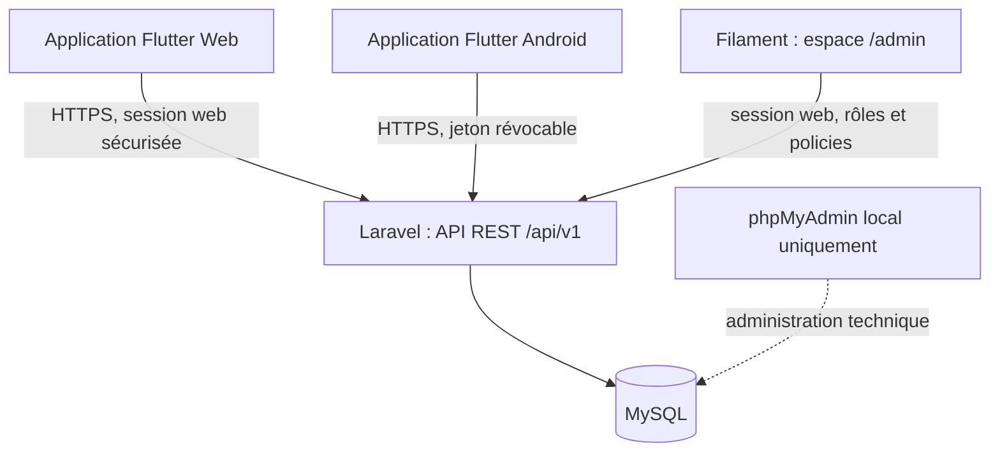

# Soutrali — Référence technique

> Document compagnon du [README de cadrage](README.md). Il précise une architecture de référence pour construire Soutrali en local, valider le MVP web, puis réutiliser le projet Flutter pour Android. Il ne modifie ni ne remplace le README de cadrage.

**Version :** 1.0 · **Date :** 20 octobre 2026 · **Langue :** français  
**Statut :** orientation Flutter web puis mobile validée par le porteur du projet ; les choix Laravel, Filament et les détails d’implémentation ci-dessous constituent la stack technique recommandée à confirmer avant le démarrage du développement.

---

## 1. Objectif et décisions de référence

Soutrali doit d’abord fonctionner complètement en local, avec une base MySQL administrée via phpMyAdmin fourni par XAMPP. Une fois les parcours du MVP validés, le service sera transféré vers un hébergement en ligne.

L’orientation suivante est validée :

- un projet Flutter/Dart partagé pour l’interface des habitants ;
- livraison du MVP en site web en premier ;
- réutilisation de ce projet pour une application Android après validation du web ;
- backend et base de données indépendants des interfaces, afin que web et mobile utilisent les mêmes règles métier et les mêmes données.

La stack de référence proposée est : **Flutter + Laravel + MySQL**, avec **Filament** pour les tâches d’administration. Le backend est un monolithe modulaire : une seule application serveur, une seule base principale, pas de microservices. Cette approche limite les composants à installer, surveiller et maintenir.

### Statut des décisions

| Sujet | Statut | Décision de référence |
|---|---|---|
| Code d’interface | Validé | Flutter/Dart partagé, web d’abord, Android ensuite |
| Base locale | Validé | MySQL fourni par XAMPP ; phpMyAdmin pour l’administration locale de la base |
| Backend | Recommandation | Laravel en application monolithique, exposant une API REST versionnée |
| Interface d’administration | Recommandation | Filament, accessible aux administrateurs et modérateurs autorisés |
| Authentification | Recommandation | Laravel Sanctum : session sécurisée pour le web, jetons révocables pour Android |
| Hébergement | Ouvert | Choisir après vérification des exigences Laravel, MySQL, sauvegardes et coûts |
| Versions exactes | À fixer au démarrage | Choisir des versions stables compatibles, les tester et les figer dans les fichiers de verrouillage |

Cette documentation ne transforme pas les recommandations en décisions déjà approuvées. Avant de coder, le porteur du projet confirme la stack de référence et les décisions produit qui conditionnent l’authentification et les contacts (notamment D-04 et D-05 du README).

---

## 2. Architecture cible



### Responsabilités des composants

| Composant | Responsabilité | Ne doit pas faire |
|---|---|---|
| Flutter | Affichage, navigation, formulaires, validation d’expérience utilisateur, appels API, états de chargement et d’erreur | Se connecter directement à MySQL ou décider seul des permissions métier |
| Laravel | Authentification, autorisations, validation définitive, règles métier, API, journaux applicatifs et accès aux données | Dépendre du navigateur pour protéger une action ou une donnée |
| MySQL | Stockage relationnel des comptes, annonces, référentiels, interactions et signalements | Être accessible depuis l’application Flutter ou depuis Internet sans nécessité contrôlée |
| Filament | Interface web de gestion des signalements, annonces, catégories, communes, rôles et comptes | Remplacer l’API publique ou donner automatiquement tous les droits aux employés |
| XAMPP / phpMyAdmin | Environnement local Apache/PHP/MySQL et outil graphique de consultation de la base | Constituer l’environnement de production ou devenir l’interface quotidienne des modérateurs |

### Pourquoi un monolithe Laravel

Laravel réunit dans un même framework les routes, contrôleurs, validation, migrations de base, authentification, politiques d’accès, tâches planifiées et tests. Le panneau Filament partage les modèles et règles du même serveur. Il n’y a donc pas de second backend d’administration à maintenir, ni de synchronisation entre plusieurs services.

Le projet ne démarre pas avec Redis, Kubernetes, des microservices, une messagerie temps réel ou un moteur de recherche séparé. Ces éléments ne répondent pas à un besoin du MVP et augmenteraient le coût d’exploitation. Une file de tâches basée sur la base de données peut être ajoutée si les notifications par e-mail sont retenues ; elle n’est pas obligatoire pour les premiers parcours.

---

## 3. Stack technique

| Couche | Technologie de référence | Utilisation et justification |
|---|---|---|
| Interface habitants | Flutter, langage Dart, canal stable | Une base de code pour l’interface web puis Android. Le web est la première cible ; le comportement doit rester adapté aux navigateurs et aux appareils tactiles. |
| Navigation Flutter | `go_router` | Routes nommées, liens profonds et redirections selon l’état de connexion, sans construire un routeur maison. |
| Appels HTTP Flutter | `dio` | API JSON, gestion centralisée des erreurs, délais d’attente, en-têtes et comportement avec les cookies dans le navigateur. |
| État de l’interface | Gestion simple par fonctionnalités ; `flutter_riverpod` seulement si l’équipe en confirme l’utilité | Éviter une architecture d’état disproportionnée. Ne pas multiplier les bibliothèques de gestion d’état. |
| Stockage de session mobile | Stockage sécurisé de la plateforme, par exemple `flutter_secure_storage` | Stocker les jetons Android dans le stockage protégé de l’appareil, jamais dans un fichier en clair. |
| Backend / API | PHP avec Laravel, monolithe modulaire | API REST JSON et application serveur centrale ; règles métier testables côté serveur. |
| Authentification API | Laravel Sanctum | Sessions web sécurisées pour le client web de première partie et jetons personnels révocables pour Android. |
| Administration métier | Filament pour Laravel | Formulaires, listes, filtres et actions administratives construites à partir des modèles Laravel ; accès protégé par rôle et policy. |
| Base de données | MySQL ; MariaDB fourni par certaines versions de XAMPP peut être utilisé localement après vérification de compatibilité | Base relationnelle cohérente avec les entités du cahier des charges. Consigner le moteur et sa version dans le guide d’installation. |
| Administration locale de la base | phpMyAdmin (XAMPP) | Interface d’administration SQL, distincte du moteur de base. Création de la base et diagnostic ponctuel par l’équipe technique ; ce n’est pas l’outil des modérateurs. |
| Serveur local | XAMPP Apache/PHP/MySQL, Composer et outils Flutter/Dart | Permet le développement local. La version PHP réellement utilisée par Apache et la version CLI doivent toutes deux satisfaire la version Laravel choisie. |
| Tests backend | PHPUnit ou Pest, selon le choix fait au lancement | Tests unitaires des règles métier et tests HTTP/API des permissions, validations et réponses. Un seul framework de test est retenu. |
| Tests Flutter | `flutter_test` et tests d’intégration ciblés | Vérifier les widgets critiques et les parcours essentiels sur mobile et web. |
| Versionnement | Git, dépôt privé ou public contrôlé | Historique, revues, branches courtes, tags de versions et partage du même code entre contributeurs. |
| Vérification API | Bruno ou Postman | Collections de requêtes versionnées pour l’API, les erreurs et les rôles. Aucun secret réel dans les collections. |
| Maquettes | Figma, si validé par l’équipe | Maquettes mobile-first et revue des états de formulaire avant implémentation. |

Les noms de bibliothèques sont des choix de référence, pas des versions figées. Au lancement, relever les versions compatibles et maintenues, puis enregistrer les versions exactes dans `pubspec.lock`, `composer.lock` et le document d’installation. Ne pas utiliser une dépendance non maintenue ou une version flottante en production.

---

## 4. Architecture applicative et organisation du code

### Backend Laravel

Organiser le backend par domaines fonctionnels, sans architecture en couches complexe ni logique métier dans les contrôleurs :

```text
backend/
  app/
    Enums/                 # rôles, statuts et types métier
    Http/Controllers/Api/V1/
    Http/Requests/          # validation des entrées HTTP
    Models/                 # modèles Eloquent et relations
    Policies/               # autorisations par ressource
    Services/               # règles métier réutilisées par API et administration
    Filament/               # ressources et pages du panneau d'administration
  database/
    migrations/
    seeders/
    factories/
  routes/
    api.php
    web.php
  tests/
    Feature/
    Unit/
```

Les contrôleurs restent minces : ils reçoivent une requête validée, appellent le domaine/service approprié et renvoient une ressource JSON cohérente. Les mêmes règles doivent être appelées depuis l’API et depuis Filament ; une action d’administration ne doit pas contourner les règles de statut ou de traçabilité.

### Application Flutter

```text
app/
  lib/
    app/                   # démarrage, thème, routes
    core/                  # client HTTP, configuration, erreurs communes
    features/
      auth/
      listings/
      profile/
      reports/
      moderation/          # uniquement si l’interface modérateur Flutter est justifiée
  test/
```

Chaque fonctionnalité sépare au minimum l’affichage, les appels au dépôt/API et les modèles de transfert utiles. Les règles de sécurité restent dans Laravel. La mise en page Flutter doit être conçue pour le téléphone, puis s’adapter au web ; « même code source » ne signifie pas une interface identique au pixel près sur chaque taille d’écran.

### Espaces d’URL proposés en production

Pour réduire la configuration CORS et simplifier les cookies de session, privilégier une origine principale :

- `/` : application Flutter Web ;
- `/api/v1/...` : API Laravel ;
- `/sanctum/...` : routes techniques d’authentification web ;
- `/admin` : Filament, réservé aux rôles habilités.

Les routes inconnues de l’application web doivent retomber sur le fichier d’entrée Flutter, sans intercepter les routes API ni l’espace Filament. Cette configuration doit être vérifiée avec l’hébergeur Apache ou Nginx retenu. Si l’hébergement impose des sous-domaines, la configuration des cookies, du domaine Sanctum et du CORS devra être adaptée et testée explicitement.

---

## 5. API et règles de contrat

L’API est versionnée dès le début sous `/api/v1`. Elle utilise HTTPS en production, JSON en entrée/sortie, des codes HTTP standard et une pagination côté serveur.

Exemples de ressources (à ajuster aux décisions produit avant implémentation) :

| Domaine | Routes indicatives |
|---|---|
| Compte | `POST /api/v1/register`, `POST /api/v1/login`, `POST /api/v1/logout`, `GET /api/v1/me` |
| Annonces publiques | `GET /api/v1/listings`, `GET /api/v1/listings/{id}` |
| Annonces du compte | `POST /api/v1/listings`, `PATCH /api/v1/listings/{id}`, `POST /api/v1/listings/{id}/close` |
| Contact | `POST /api/v1/listings/{id}/interactions` |
| Signalement | `POST /api/v1/listings/{id}/reports` |
| Référentiels | `GET /api/v1/categories`, `GET /api/v1/communes` |

Les routes sont indicatives : la méthode d’inscription et le canal de contact (D-04, D-05) ne sont pas encore tranchés dans le README.

### Contrat de réponse

- Réponses de succès avec une structure JSON constante et documentée.
- Erreurs de validation en `422`, accès interdit en `403`, session absente ou invalide en `401`, ressource absente en `404`, limitation de débit en `429`.
- Les messages destinés à l’interface ne révèlent ni requête SQL, ni trace technique, ni secret.
- Les listes filtrées sont paginées ; la limite maximale de page est imposée par le serveur.
- Les filtres sont validés sur le serveur ; une annonce masquée ou clôturée ne réapparaît pas dans les résultats actifs.
- Les coordonnées privées ne sont jamais incluses dans une réponse visiteur. L’autorisation d’accès aux champs de contact est calculée côté serveur selon le consentement et l’état de session.

---

## 6. Données et MySQL

Le schéma suit le modèle conceptuel du README et est créé par migrations versionnées, jamais uniquement par des modifications manuelles dans phpMyAdmin.

| Table de référence | Rôle et contraintes essentielles |
|---|---|
| `users` | Identifiant de connexion, mot de passe haché par Laravel, rôle unique, statut, profil et préférence de contact. L’identifiant et les contacts privés ont des règles d’accès strictes. |
| `categories` | Libellé et statut actif ; une catégorie désactivée n’est plus proposée, mais les anciennes annonces restent consultables selon les règles métier. |
| `communes` | Référentiel géographique d’Abidjan ; quartier stocké séparément comme texte libre si ce choix est confirmé. |
| `listings` | Auteur, catégorie, commune, type, nature, texte, disponibilité, budget facultatif, statut, issue de clôture et dates. Les clés étrangères et index correspondent aux recherches prévues. |
| `interactions` | Trace d’une prise de contact, protégée et non publique ; n’enregistrer que les champs nécessaires à la fonctionnalité validée. |
| `reports` | Motif, détails facultatifs, auteur du signalement, annonce ciblée, état et dates ; accès restreint. |
| `moderation_actions` | Décision, justification, modérateur, signalement concerné et date ; historique append-only autant que possible. |
| tables Laravel nécessaires | Sessions, jetons Sanctum et tâches planifiées éventuelles, uniquement lorsque la fonctionnalité correspondante est activée. |

Principes de stockage : identifiants et relations par clés étrangères ; dates normalisées ; montants stockés dans un type décimal approprié si le budget est retenu ; index sur statut, commune, catégorie, type et date selon les requêtes observées. Éviter les colonnes JSON pour remplacer des relations structurées.

Au démarrage, une recherche par mot-clé simple et paginée suffit au pilote. Mesurer les performances avant d’ajouter un moteur externe. Les migrations doivent pouvoir s’exécuter sur une base neuve ; des seeders fournissent catégories et communes de démonstration sans données personnelles réelles.

---

## 7. Authentification, rôles et administration

### Authentification proposée

- **Flutter Web :** session de première partie par cookie `HttpOnly`, `Secure` en production et protection CSRF, via le flux SPA de Laravel Sanctum. Le frontend et l’API sont servis sur la même origine de préférence. Les jetons d’authentification ne sont pas stockés dans `localStorage`.
- **Flutter Android :** jeton Sanctum transmis en Bearer, stocké dans le stockage sécurisé de l’appareil et révocable à la déconnexion ou depuis l’administration du compte.
- **Inscription et récupération :** leur mode exact dépend de D-04. Ne pas ajouter l’envoi SMS, un fournisseur de courriel ou un coût récurrent avant d’avoir choisi le parcours et son fournisseur.
- Les mots de passe sont hachés avec les mécanismes sûrs du framework ; ils ne sont jamais réversibles ni journalisés.

### Rôles

Le modèle reste simple : `UTILISATEUR`, `MODERATEUR`, `ADMINISTRATEUR`. Les droits sont vérifiés dans Laravel au moyen de policies/gates sur chaque action et ressource. Masquer un bouton dans l’interface n’est jamais une mesure de sécurité. Aucun système de permissions tiers n’est nécessaire au MVP tant que le modèle de rôles reste celui-ci.

### Panneau Filament

Filament est l’outil métier des personnes qui administrent Soutrali, distinct de phpMyAdmin. Il doit fournir les tâches réellement prévues :

- file de signalements avec filtre par état, date et motif ;
- consultation de l’annonce et de son historique ;
- décision motivée : classer, masquer, restaurer ou transmettre selon les règles validées ;
- gestion des catégories et communes, avec désactivation plutôt que suppression si elles sont référencées ;
- consultation limitée des comptes, suspension et réactivation selon une procédure traçable ;
- journal des actions de modération, avec auteur et horodatage.

Le rôle administrateur est accordé explicitement par un mécanisme de création initiale contrôlé. Ne jamais laisser une inscription publique choisir son propre rôle. En production, protéger `/admin` par HTTPS, limiter les comptes privilégiés, appliquer une politique de mots de passe et prévoir une procédure de récupération. L’authentification à deux facteurs peut être ajoutée après analyse du niveau de risque et des options réellement maintenues.

---

## 8. Environnement local : XAMPP

### Pré-requis à installer

1. Git et un éditeur de code.
2. Flutter SDK et Dart SDK sur le canal stable, avec les dépendances de compilation Android si l’émulateur ou un appareil Android est utilisé.
3. XAMPP avec Apache, MySQL et une version PHP compatible avec la version Laravel sélectionnée.
4. Composer pour installer les dépendances PHP et exécuter Artisan.
5. Un navigateur récent ; Bruno ou Postman pour les vérifications API.

Les versions ne sont pas fixées dans ce document : elles doivent être vérifiées au démarrage, consignées dans la documentation d’installation puis utilisées par tous les contributeurs. Vérifier séparément `php -v` (CLI), le PHP chargé par Apache, Composer, Flutter et MySQL. Un écart CLI/Apache peut produire des erreurs trompeuses.

### Mise en route locale prévue

1. Cloner le dépôt et installer les dépendances Flutter et PHP avec les fichiers de verrouillage du projet.
2. Démarrer Apache et MySQL dans XAMPP.
3. Vérifier dans XAMPP quel moteur SQL est effectivement installé : phpMyAdmin est l’interface d’administration et ne détermine pas si le serveur est MySQL ou MariaDB. Si la version XAMPP retenue fournit MariaDB, confirmer sa compatibilité avec la version Laravel choisie et consigner ce choix ; si le projet exige strictement MySQL, installer le serveur MySQL approprié et configurer phpMyAdmin pour s’y connecter.
4. Dans phpMyAdmin, créer une base dédiée et un utilisateur local avec les droits limités à cette base. Éviter l’usage du compte `root` sans mot de passe dans la configuration de l’application.
5. Copier le modèle d’environnement fourni en `.env`, renseigner les paramètres locaux et générer la clé Laravel. Le fichier `.env` réel reste ignoré par Git.
6. Exécuter les migrations et les seeders de référence pour construire un environnement reproductible.
7. Lancer l’API Laravel et l’application Flutter Web en mode développement, avec les origines locales prévues dans la configuration CORS/Sanctum.
8. Pour valider l’authentification web de bout en bout, servir aussi un build Flutter Web depuis l’origine locale configurée pour le backend ; configurer l’envoi des cookies et l’en-tête CSRF pour les requêtes mutantes. Ne pas conclure à la validité des cookies à partir d’un test isolé sur des ports différents.
9. Vérifier les parcours avec des comptes de test pour chaque rôle et des données fictives.

Les commandes exactes seront consignées dans un guide d’installation une fois les versions et l’arborescence du dépôt décidées. Ne pas coller de secrets, mots de passe réels ou données personnelles dans ce document, les tickets ou les captures d’écran.

### Configuration par environnement

Les paramètres sensibles et variables par environnement proviennent de variables d’environnement, jamais du code Flutter ou d’un dépôt Git : connexion MySQL, clé Laravel, domaines de session, origine CORS, URL de base API, SMTP éventuel et stockage de fichiers. Les paramètres publics du client Flutter ne doivent contenir aucun secret serveur.

---

## 9. Interface web et application mobile

### Parcours de livraison

1. Développer et tester les fonctionnalités de l’API et du panneau d’administration.
2. Construire les écrans Flutter mobile-first et les valider dans les navigateurs ordinateur et téléphone.
3. Générer le build Flutter Web et le servir depuis l’hébergement de l’application ; garder l’API Laravel et le panneau Filament sur la même origine si possible.
4. Faire valider les critères MVP en environnement local, puis sur une préproduction accessible à l’équipe.
5. Reprendre le même dossier source Flutter pour compiler Android ; ajouter seulement les adaptations nécessaires aux permissions, liens externes et tailles d’écran.
6. Tester Android sur appareils réels et réseaux variables avant distribution.

Le code métier côté interface (modèles, validation visuelle, navigation et client API) est partagé. Les builds web et Android sont des artefacts différents. Les fonctionnalités natives spécifiques ne sont ajoutées que lorsqu’un besoin l’exige.

### Responsive et usages

- Concevoir d’abord les parcours à partir de 360 px de largeur, conformément au README.
- Prévoir clavier, focus, libellés accessibles, états vides, chargement et erreurs réseau.
- Conserver les saisies utiles pendant une erreur de soumission ; les données sensibles ne sont pas persistées localement sans besoin validé.
- Limiter les médias et le poids initial pour les connexions mobiles variables.
- Tester web dans les navigateurs mobiles ciblés ; tester Android au minimum sur un appareil réel courant et un émulateur si disponible.

---

## 10. Qualité, tests et critères de sortie

| Niveau | Vérifications attendues |
|---|---|
| Backend unitaire | Transitions de statut, clôture, nature bénévole/rémunérée, règles de visibilité et permissions métier. |
| Backend fonctionnel/API | Inscription/connexion selon D-04, visiteurs, utilisateur, modérateur et administrateur ; validations et codes d’erreur ; filtres combinés ; pagination ; absence de fuite de coordonnées. |
| Administration | Actions Filament autorisées ou refusées selon rôle ; chaque décision de modération est attribuée et horodatée ; catégories désactivées conservées pour l’historique. |
| Flutter | Validation des formulaires, états de chargement/erreur/vide, navigation, reprise des saisies et affichage des erreurs API. |
| Intégration | Parcours complets navigateur → API → MySQL, puis Android → API → MySQL ; session web et jeton mobile testés séparément. |
| Régression manuelle | Largeur 360 px, navigateur ordinateur, réseau coupé/rétabli, compte suspendu, annonce clôturée ou masquée. |

La définition de « terminé » pour une fonctionnalité inclut : règles métier côté serveur, contrôle d’accès, états d’erreur visibles, tests pertinents, revue du changement et documentation de configuration mise à jour si nécessaire.

### Critères minimaux avant de déclarer le MVP localement validé

- Les critères CA-01 à CA-15 du README sont couverts par des tests automatisés ou un scénario de recette tracé.
- Une base neuve peut être créée par migrations et chargée avec des données de démonstration.
- Un visiteur ne reçoit aucune coordonnée privée dans les réponses API.
- Un utilisateur ne peut modifier ni clôturer une annonce appartenant à un autre compte, même en appelant directement l’API.
- Un modérateur peut traiter un signalement et l’action est traçable ; le signalement ne supprime pas automatiquement l’annonce.
- L’application web et les parcours essentiels restent utilisables sur téléphone.
- Les erreurs serveur ne dévoilent pas de trace, de requête SQL, de secret ni de configuration.

---

## 11. Sécurité et confidentialité

Les protections minimales suivantes sont requises avant toute exposition publique :

- HTTPS partout en production ; configuration correcte des cookies, CSRF et CORS.
- Validation serveur de chaque entrée et autorisation par policy sur chaque action protégée.
- Hachage des mots de passe par Laravel, limitation des tentatives d’authentification et limitation de débit sur les routes sensibles.
- Protection contre l’énumération de comptes et réponses d’erreur ne révélant pas l’existence d’un compte lorsque cela s’applique.
- Cookies de session `HttpOnly`, `Secure` et `SameSite` adapté à l’architecture ; jetons Android révocables et jamais intégrés au binaire.
- Aucun accès MySQL depuis Flutter ; identifiants SQL à privilèges minimaux et accès réseau restreint en hébergement.
- Journaux sans mots de passe, jetons, coordonnées privées ou contenu de contact inutile ; accès aux journaux limité.
- Sauvegardes chiffrées ou protégées, accès limité et test de restauration documenté.
- Dépendances verrouillées et mises à jour de sécurité traitées avant mise en production.
- Politique de conservation, suppression et droits des personnes définie après validation juridique locale ; ne pas collecter de pièce d’identité ni de géolocalisation précise pour le MVP.

phpMyAdmin ne doit jamais être exposé publiquement comme outil d’administration de production. En production, l’équipe technique utilise un accès de base restreint fourni par l’hébergeur ; les modérateurs utilisent Filament.

---

## 12. Sauvegardes, exploitation et reprise

### En local

- Utiliser migrations et seeders pour reconstruire la structure et les données de démonstration.
- Ne pas versionner les fichiers d’export contenant des comptes ou des données réelles.
- Sauvegarder les changements de code avec Git ; garder les fichiers `.env` séparés.

### En hébergement

- Définir la fréquence, la rétention, le responsable et l’emplacement des sauvegardes avant le pilote.
- Sauvegarder la base et les fichiers téléversés éventuels ; tester périodiquement une restauration dans un environnement distinct.
- Documenter les commandes de déploiement, migrations, retour arrière et vérifications après mise en ligne.
- Prévoir une adresse de supervision, une procédure de signalement d’incident et un responsable opérationnel.
- N’activer le planificateur Laravel que si une fonction réelle en dépend. Ne pas déployer de workers permanents avant d’avoir décidé d’une file de tâches.

Le niveau de disponibilité, la rétention et les coûts ne sont pas fixés ici : ils dépendent du choix d’hébergement et doivent être validés avant le lancement pilote.

---

## 13. Passage du local à l’hébergement

XAMPP est un environnement de développement, pas un serveur de production recommandé. Le passage en ligne consiste à déployer les mêmes composants applicatifs sur un hébergement compatible, avec une base distincte et des secrets distincts.

### Capacités à vérifier chez l’hébergeur

- version PHP compatible avec le Laravel retenu et extensions PHP nécessaires ;
- Composer disponible pour installer les dépendances ou mécanisme de build documenté ;
- MySQL compatible, sauvegardes automatiques disponibles et procédure de restauration ;
- document root configurable vers le dossier public Laravel ;
- HTTPS, variables d’environnement sécurisées et accès aux journaux ;
- accès SSH/CLI ou solution équivalente pour les migrations et commandes de déploiement ;
- réécriture d’URL permettant les routes Flutter, Laravel et Filament sans conflit ;
- stockage suffisant et sauvegardable si des fichiers sont introduits plus tard.

### Séquence de mise en ligne

1. Créer un environnement de préproduction et une base vide distincte de la base locale.
2. Déployer le backend et injecter les variables secrètes depuis le panneau sécurisé de l’hébergeur.
3. Exécuter les migrations contrôlées et les seeders strictement nécessaires ; ne pas recopier les comptes de test.
4. Construire Flutter Web avec l’URL d’API de l’environnement cible, puis publier les fichiers statiques.
5. Configurer HTTPS, cookies Sanctum, domaines autorisés, CORS, en-têtes de sécurité et limites de débit.
6. Vérifier les parcours visiteurs, compte, publication, clôture, signalement et administration en préproduction.
7. Effectuer une sauvegarde et vérifier la restauration avant le pilote.
8. Publier le pilote, surveiller les erreurs et corriger selon la procédure de changement.
9. Après validation web, compiler Android en pointant vers l’API de production, puis tester avant toute distribution.

Ne jamais copier le `.env` local en production. Ne pas publier une base de production par phpMyAdmin ouvert à Internet. Ne pas exécuter une migration destructive sans sauvegarde, revue et procédure de retour arrière.

---

## 14. Dépôt, collaboration et versions

Organisation de dépôt recommandée :

```text
soutrali/
  app/                     # projet Flutter partagé web/Android
  backend/                 # Laravel, API et Filament
  docs/
    README.md              # cadrage fonctionnel de référence
    README_TECHNIQUE.md    # ce document, une fois placé dans docs/
    INSTALLATION.md        # procédure locale à compléter après choix des versions
    API.md                 # contrat API détaillé à maintenir avec les routes
  .gitignore
```

Le dépôt existant peut conserver une autre organisation ; cette structure est une proposition à adapter lors de la création du code. Les documents du dossier « Documentation v2 Soutrali » peuvent rester séparés du dépôt applicatif si le dépôt partagé est organisé autrement.

Règles de collaboration recommandées :

- protéger la branche principale et intégrer les changements par pull request/revue ;
- découper le travail en tickets correspondant à des critères d’acceptation ;
- versionner migrations, tests, seeders et collections API ;
- ne jamais committer `.env`, clés, sauvegardes ou exports de données ;
- conserver `composer.lock` et `pubspec.lock` dans le dépôt ;
- chaque changement de modèle met à jour migration, tests, API et documentation concernée ;
- distinguer local, préproduction et production par configuration, jamais par copies manuelles du code source.

---

## 15. Phasage technique

| Étape | Livrable | Condition de passage |
|---|---|---|
| T0 — Arbitrages | Stack confirmée ; D-04, D-05, D-06 clarifiées ; choix d’hébergement étudié sans achat prématuré | Les parcours et mécanismes d’authentification sont décidés |
| T1 — Socle local | Dépôt, versions verrouillées, Laravel, MySQL/XAMPP, migrations, seeders, tests automatisés | Installation reproductible sur une machine propre |
| T2 — Comptes et administration | Authentification, profils, rôles, Filament, catégories et communes | Permissions validées pour chaque rôle |
| T3 — Annonces | Création, recherche filtrée, détail, modification et clôture | Critères fonctionnels des annonces validés |
| T4 — Confiance et contact | Contacts selon D-05, signalement, file et décisions de modération traçables | Aucune coordonnée visible sans autorisation ; modération vérifiée |
| T5 — Flutter Web | Écrans MVP, responsive, états réseau, intégration réelle à l’API | Recette CA-01 à CA-15 réussie en local |
| T6 — Préproduction | Hébergement choisi, HTTPS, variables sécurisées, sauvegardes et restauration vérifiées | Validation opérationnelle et sécurité de base |
| T7 — Pilote web | Mise en ligne limitée, suivi des incidents et retours utilisateurs | Décision du porteur après observation du pilote |
| T8 — Android | Build Flutter Android, stockage sécurisé, essais appareils/réseaux | Parcours principaux validés sur appareils cibles |

Les étapes peuvent être ajustées au backlog ; elles ne fixent ni délai ni budget non validé.

---

## 16. Points à confirmer avant développement

1. Confirmer Laravel + Filament + Sanctum comme choix de référence, ainsi que les versions compatibles disponibles au démarrage.
2. Choisir inscription et récupération de compte (D-04) : e-mail, téléphone, ou autre parcours validé ; identifier tout coût de SMS/courriel.
3. Définir précisément le contact entre membres et sa trace (D-05). Ne pas développer une messagerie interne sans décision de périmètre.
4. Décider la modération immédiate ou préalable (D-06), le rôle responsable et le délai opérationnel attendu.
5. Confirmer les catégories, communes, champs de budget et politique de conservation des données.
6. Choisir un hébergement compatible après un essai de préproduction ; déterminer domaine, région des données, sauvegardes et coûts.
7. Décider si les notifications F-09 sont dans le premier incrément ; choisir alors un fournisseur de courriel et une file de tâches proportionnée.
8. Clarifier si le rôle modérateur utilisera Filament sur ordinateur uniquement ou s’il faut aussi une interface Flutter adaptée au téléphone.

---

## 17. FAQ — fonctionnement local, mobile et exploitation

Cette FAQ complète le parcours technique prévu. Les choix d’hébergement, les versions logicielles et les décisions produit encore ouvertes restent à confirmer avant le lancement.

### Questions du porteur du projet

#### « Puisque nous allons utiliser XAMPP pour l’hébergement local et la gestion de la base de données, au cas où l’application est en ligne en mobile par exemple, comment les utilisateurs utiliseront ça ? En back-end, si l’appli est installée, comment le reste est géré ? »

**Réponse :** l’application installée sur le téléphone est la partie visible par l’utilisateur. Le backend Laravel et la base MySQL ne sont pas installés sur chaque téléphone : ils tournent sur un serveur central accessible par Internet.

En développement, XAMPP fait tourner les services sur l’ordinateur de l’équipe : PHP/Apache pour le backend et un serveur SQL pour les données. phpMyAdmin est l’interface graphique utilisée par les développeurs pour administrer cette base. Flutter Web et les téléphones de test peuvent appeler le backend local. Pour qu’un téléphone accède temporairement à cet ordinateur, les deux appareils doivent généralement être sur le même réseau, l’ordinateur doit rester allumé et le pare-feu doit autoriser la connexion. Cette méthode sert aux essais internes, pas au lancement public.

Après validation locale, l’équipe déploie l’application Laravel et la base de données sur un hébergement compatible, accessible en permanence. Un nom de domaine et HTTPS permettent aux clients de communiquer avec le serveur, par exemple via une adresse d’API telle que `https://api.exemple.ci` (adresse illustrative, domaine non choisi). L’application Flutter est compilée pour Android avec l’adresse de l’API de production configurée. Lorsqu’un utilisateur ouvre l’application, elle envoie ses demandes par Internet à Laravel ; Laravel vérifie la session ou le jeton, applique les règles et permissions, lit ou met à jour MySQL, puis renvoie une réponse à l’application.

Les utilisateurs n’installent donc ni Laravel, ni MySQL, ni XAMPP. Ils n’ont besoin que de l’application et d’une connexion Internet pour les fonctions qui consultent ou modifient les données partagées. Les données communes restent sur le serveur afin que les annonces publiées par une personne soient visibles par les autres utilisateurs autorisés.

Les administrateurs et modérateurs utilisent un panneau web sécurisé, par exemple Filament sur `/admin`, pour traiter les signalements, gérer les annonces et administrer les catégories ou communes. Ce panneau est une interface métier qui passe par Laravel et ses contrôles d’accès. phpMyAdmin reste un outil technique réservé aux personnes autorisées à maintenir la base ; il ne doit pas être exposé publiquement ni utilisé par les modérateurs dans leurs tâches quotidiennes.

En résumé : **XAMPP est l’atelier local de développement ; l’hébergement en ligne est le serveur permanent utilisé par le site et les téléphones.** Le code backend peut rester le même, mais la configuration, la base, les secrets et les domaines de production sont distincts de ceux du poste local.

#### « Est-ce que le backend sera intégré dans l’application mobile ? »

Non. L’application contient l’interface Flutter et l’adresse publique de l’API, mais pas les identifiants de la base ni les secrets du serveur. Chaque appel sensible est envoyé à Laravel, qui authentifie le compte, vérifie ses droits et applique les règles métier. Mettre les identifiants MySQL dans une application installée exposerait toute la base et est interdit par l’architecture.

#### « Que se passe-t-il si l’ordinateur avec XAMPP est éteint ? »

En local, le backend et les données de cet ordinateur ne sont plus accessibles aux autres appareils. En production, le serveur est fourni par un hébergeur conçu pour rester accessible en continu. XAMPP n’est pas le serveur public de Soutrali ; il sert à construire et vérifier le produit avant son déploiement.

### Questions fréquentes des débutants

#### « XAMPP, phpMyAdmin, MySQL et Laravel, est-ce la même chose ? »

Non. XAMPP est un paquet d’outils de développement local. Le serveur SQL stocke les données ; selon la version de XAMPP, il peut s’agir de MySQL ou de MariaDB. phpMyAdmin est une interface web qui permet d’administrer un serveur SQL. Laravel est le backend PHP qui reçoit les requêtes de l’application, applique les règles et communique avec la base. Il faudra vérifier le moteur SQL et sa version dans l’installation retenue.

#### « Les utilisateurs doivent-ils installer XAMPP ou phpMyAdmin ? »

Non. Ces outils servent à l’équipe technique pendant le développement et, avec précautions, à l’administration technique. Les utilisateurs accèdent au site avec leur navigateur ou installent l’application mobile. Ils n’accèdent jamais directement à phpMyAdmin ou à la base.

#### « Un utilisateur peut-il utiliser l’application sans Internet ? »

Les principales fonctions du MVP — recherche d’annonces à jour, connexion, publication, contact et signalement — nécessitent une connexion au serveur. Une mise en cache ou un mode hors ligne n’est pas prévu par défaut : il faudrait définir quelles données peuvent être stockées, pendant combien de temps, et comment synchroniser les modifications sans conflit. L’application doit plutôt afficher clairement l’absence de réseau, conserver les champs non sensibles saisis durant une erreur autant que possible, puis permettre de réessayer.

#### « Le même code Flutter veut-il dire que le site et l’application sont identiques ? »

Ils partagent le projet, les modèles utiles, les écrans et les appels à la même API, mais les artefacts compilés sont différents. L’interface doit s’adapter à la taille de l’écran et aux usages du navigateur ou du téléphone. La version Android peut nécessiter une configuration propre à la plateforme, par exemple pour les liens externes et le stockage sécurisé des jetons.

#### « Est-ce que l’application Android pourra utiliser les données du site ? »

Oui, si le site web et Android utilisent le même backend en ligne et la même base de production. Ils utilisent le même compte et les mêmes règles d’accès. Une annonce publiée sur le web peut alors être consultée sur mobile, sous réserve de son statut et des permissions prévues.

#### « Les administrateurs utiliseront-ils l’application mobile ? »

La recommandation actuelle est d’utiliser Filament depuis un navigateur pour les tâches de modération et d’administration. Le panneau est une interface web séparée des écrans publics Flutter, mais il repose sur le même backend Laravel. Une interface de modération adaptée dans Flutter ne sera ajoutée que si un besoin opérationnel est confirmé.

#### « Peut-on garder XAMPP après la mise en ligne ? »

Oui, pour développer, corriger et tester. Il faut toutefois séparer les environnements : base locale de développement, préproduction et production. Les comptes et données réelles de production ne doivent pas être copiés sans nécessité vers l’ordinateur local. Les mots de passe, clés et configurations de production restent dans l’environnement sécurisé de l’hébergeur.

### Questions fréquentes des profils IT

#### « Comment l’application mobile sait-elle quel serveur appeler ? »

L’adresse de base de l’API est configurée pour chaque build et chaque environnement : local, préproduction, production. L’adresse n’est pas un secret. En revanche, les clés Laravel, identifiants SQL, mots de passe SMTP et jetons privés ne doivent jamais être intégrés au code Flutter ou au binaire mobile. Les builds sont vérifiés pour s’assurer qu’ils pointent vers le bon environnement.

#### « Comment gérer l’authentification du web et d’Android ? »

La recommandation utilise Laravel Sanctum avec deux modes adaptés au client : session web sécurisée par cookies `HttpOnly` et protection CSRF pour Flutter Web de première partie ; jeton révocable transmis en Bearer et conservé dans le stockage sécurisé de l’appareil pour Android. Les deux clients retrouvent le même compte et les mêmes permissions côté Laravel. La configuration exacte des cookies, domaines, origines et CORS est testée de bout en bout, notamment si frontend et API sont sur des sous-domaines distincts.

#### « Quel est le rôle de Filament par rapport à l’API ? »

Filament est intégré au backend Laravel. Il fournit des écrans administratifs web, mais les contrôles d’accès et règles métier restent côté serveur. Ses actions doivent utiliser les mêmes policies et services métier que l’API. Il ne constitue ni un backend indépendant, ni un accès direct à la base. Le rôle et les actions disponibles sont limités selon les profils administrateur et modérateur.

#### « Comment synchroniser le schéma de base entre les postes et la production ? »

Les évolutions de schéma sont décrites par des migrations Laravel versionnées et revues dans Git. Chaque développeur peut reconstruire une base neuve avec les migrations et des seeders de référence. En production, les migrations sont exécutées dans une étape de déploiement contrôlée, après sauvegarde et vérification de compatibilité. Les changements destructifs nécessitent une stratégie de migration et de retour arrière ; une modification manuelle uniquement dans phpMyAdmin n’est pas la source de vérité.

#### « Comment empêcher les fuites de contacts ou les modifications non autorisées ? »

L’API ne renvoie les coordonnées privées qu’aux clients autorisés selon la décision de confidentialité retenue. Les policies Laravel contrôlent chaque opération sur chaque ressource, y compris les requêtes directes qui contournent l’interface. Des tests API vérifient les cas visiteur, utilisateur propriétaire, autre utilisateur, modérateur et administrateur. Cacher un bouton côté Flutter ne remplace jamais une autorisation backend.

#### « Que se passe-t-il si le serveur ou la base tombe en panne ? »

Les utilisateurs reçoivent un message compréhensible et peuvent réessayer ; l’application ne doit pas exposer une trace d’erreur. L’équipe technique consulte les journaux autorisés, identifie l’incident et restaure le service selon la procédure de l’hébergeur. Des sauvegardes de la base et des éventuels fichiers sont planifiées, protégées et testées par restauration. La fréquence, la rétention et le délai de reprise doivent être décidés avant le pilote selon les capacités et coûts de l’hébergement.

#### « phpMyAdmin sera-t-il disponible en production ? »

Il ne doit pas être ouvert au public. Les modérateurs utilisent Filament ; les opérations techniques sur la base sont réalisées par les personnes habilitées avec l’accès restreint fourni par l’hébergeur, idéalement via un canal sécurisé. Si phpMyAdmin est indispensable à une tâche technique, il doit être protégé, limité et désactivé ou inaccessible depuis Internet public selon les possibilités de l’hébergement.

#### « Que faut-il vérifier avant de choisir l’hébergeur ? »

La version de PHP et ses extensions doivent convenir à la version Laravel figée ; le serveur doit permettre les commandes nécessaires au déploiement et aux migrations, servir le dossier public Laravel correctement, fournir MySQL compatible, HTTPS, variables d’environnement protégées, journaux accessibles, sauvegardes et restauration. Il faut aussi confirmer la configuration des routes Flutter, API et `/admin`, ainsi que les limites de stockage et le support opérationnel. Le choix ne peut pas être arrêté sans connaître les coûts, l’assistance et les exigences de conservation des données.

#### « Faut-il déployer Redis, Docker, Kubernetes ou des microservices dès le début ? »

Non, pas pour le MVP tel qu’il est cadré. Une application Laravel monolithique et une base relationnelle constituent une architecture plus simple à comprendre et exploiter pour une petite équipe. Il faut ajouter un composant seulement lorsqu’un besoin mesuré le justifie, avec une personne capable de l’exploiter. Docker peut être étudié pour rendre l’environnement reproductible, mais ne remplace pas les choix d’hébergement ni la compréhension de XAMPP demandée pour le développement local.

#### « Quelles données sauvegarder et comment tester les sauvegardes ? »

Au minimum, la base de production et les fichiers téléversés si cette fonction est ajoutée. Les fichiers de configuration contenant des secrets sont gérés séparément par le dispositif sécurisé de l’hébergeur, pas déposés dans une archive accessible. Une sauvegarde n’est considérée fiable qu’après un test de restauration dans un environnement distinct et la vérification que l’application redémarre avec les données restaurées.

#### « Comment publier une nouvelle version de l’application ? »

Pour le web, construire et publier le nouveau build Flutter, puis déployer la version backend compatible et appliquer les migrations prévues. Pour Android, générer un nouveau build signé et le distribuer selon le canal choisi (tests internes puis plateforme de distribution à décider). Les deux versions doivent viser des contrats API compatibles pendant la période où d’anciennes versions mobiles peuvent encore être utilisées. Les secrets de signature Android sont conservés hors du dépôt.

### Questions encore ouvertes qui influencent les réponses

- Le mode d’inscription et de récupération de compte : e-mail ou téléphone (D-04).
- Le canal de contact et les informations effectivement conservées (D-05).
- L’hébergement, le domaine, les coûts, la région des données et les sauvegardes.
- Les notifications et leur fournisseur éventuel.
- Le mode opératoire des modérateurs : navigateur d’ordinateur uniquement ou besoin mobile.
- Les règles de conservation, suppression et conformité locale des données.

---

## 18. Glossaire technique

| Terme | Définition |
|---|---|
| API REST | Interface HTTP permettant à Flutter de demander ou modifier des données auprès de Laravel. |
| Build | Fichiers compilés et prêts à être servis ou installés, distincts des sources. |
| CORS | Règle du navigateur qui autorise ou bloque les appels entre origines différentes. |
| CSRF | Protection contre la soumission de requêtes web non sollicitées depuis une session active. |
| Migration | Fichier versionné qui décrit une évolution reproductible du schéma de base. |
| Monolithe modulaire | Application serveur unique organisée en domaines, sans services distribués séparés. |
| Policy | Règle serveur qui détermine si un compte peut effectuer une action sur une ressource. |
| Sanctum | Mécanisme Laravel de sessions SPA et de jetons personnels API. |
| Seed | Données de référence ou de démonstration installées de manière reproductible. |
| XAMPP | Ensemble local incluant notamment Apache, PHP, un serveur SQL dont le moteur dépend de la version distribuée, et phpMyAdmin. Vérifier le moteur exact fourni par l’installation retenue. |

---

*Document technique de référence proposé pour Soutrali. Les arbitrages métier et les choix marqués « recommandation » restent à confirmer avant leur mise en œuvre.*